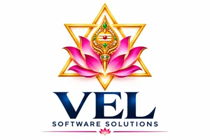

<p align="center"></p>

# 01 — Company-Wide Operating Framework

One lifecycle, twelve gates, one project record. Nobody skips a gate without written management authorisation (recorded in the project's `gates.md`).

## 1. Lifecycle and gates

| Gate | After stage | Approver | Evidence required (blocking) |
|---|---|---|---|
| 1 | Market validation | Founder | ≥10 customer interviews; scored opportunity; ≥3 customers willing to pay |
| 2 | Customer process approval | Customer process owner | Signed AS-IS map with volumes, times, error rate |
| 3 | Feasibility | Architect | Chosen automation class with justification (simplest that works) |
| 4 | Scope freeze | Customer + PM | Frozen I/O spec, rules, integrations, accuracy target, budget, timeline |
| 5 | Architecture | Architect + Security | Diagram, threat model, agent spec (if any), data-flow with PII marked |
| 6 | Workflow and UI | Customer | Clickable approval UI + TO-BE workflow signed |
| 7 | Development review | Tech lead | PR reviews, CI green, coverage on business rules |
| 8 | AI quality and security | QA lead + Security | Eval report meets thresholds; OWASP LLM checklist passed |
| 9 | Costing and pricing | Founder | `assert_quotable()` passes (all prices verified), margin ≥ target |
| 10 | Deployment | DevOps + Founder | Restore test done, alerts live, rollback tested |
| 11 | Customer acceptance | Customer | UAT signed on real (authorised) data |
| 12 | Maintenance handover | Customer Success | Runbook, SLA, monitoring owner named |

Change requests after Gate 4: written, estimated (hours, ₹, days), approved by both sides, logged.

## 2. Choosing the technology class (Phase 2.5 / 3.6)

Always pick the first row that solves the problem reliably.

| Class | Use when | Do not use when |
|---|---|---|
| Rule-based / API integration | Inputs structured, rules explicit | Inputs are free text or documents |
| Traditional RPA / Playwright | System has no API, UI is stable | Official API exists; the site forbids automation or uses CAPTCHA |
| AI-assisted workflow (LLM step inside a fixed flow) | Unstructured input, structured output, fixed steps | Steps vary per case |
| RAG | Answers must come from private documents with citations | The answer is computable |
| Tool-using agent | Path depends on intermediate results, bounded tools | A fixed flow works (most cases) |
| Multi-agent | Independent responsibilities, separate permissions | You only want it to look advanced |

Default stack: **n8n (orchestration, triggers, approvals) + Python/FastAPI services (extraction, validation, rules) + PostgreSQL (+ pgvector)**. Verify licence of n8n before embedding in a resold product (its source-available licence restricts offering it as a hosted service to third parties; confirm with a lawyer and the current licence text).

## 3. Standard workflow state machine

```
Trigger → Validate input → Dedupe (idempotency key) → Process (rules)
→ AI step (schema-constrained) → Validate output (schema + business rules + confidence)
→ [low confidence or high value] Human approval → Execute action → Log + notify
          ↘ any failure: retry with backoff → dead-letter queue → human exception queue
```

Non-negotiables:
1. Model output is **never** trusted. Validate against a JSON schema and domain rules (e.g. GSTIN checksum, totals reconcile).
2. Every external write has an **idempotency key** (`customer_id + source_id + action`).
3. Approval screen shows the exact action and its consequence.
4. Agents get least-privilege tools; no unrestricted email, payments, shell or database.
5. Untrusted documents are data, never instructions (prompt-injection rule).
6. Per-run and per-tenant token and ₹ caps; hard timeout; max steps.

## 4. Standard repository template

```
<project>/
  apps/api  apps/admin
  workflows/n8n  (exported JSON, versioned)
  src/{core,integrations,models,services,tools,prompts,schemas,security,observability}
  tests/{unit,integration,workflow,evaluation,security}
  data/sample           # synthetic only; never customer data
  docs/{requirements,architecture,api,deployment,testing,operations}
  infra/  scripts/  .github/workflows/
  .env.example  README.md  CONTRIBUTING.md
```
Rules: protected `main`, PR + 1 review, CI runs lint/tests/dependency scan/secret scan, prompts and eval sets are versioned files, no secrets in git, three environments (local / staging / production) with separate keys.

## 5. Roles (small teams combine them)

| Role | Owns | Minimum team that covers it |
|---|---|---|
| Founder / Product | Gates 1, 9; pricing; customers | 1 |
| Solutions architect + AI engineer | Gates 3, 5; prompts; evals | 1–2 |
| Backend / workflow developer | Services, n8n flows, integrations | 1–2 |
| QA and AI-eval engineer | Gate 8; regression sets | 1 (part-time at ≤3 people) |
| DevOps + security | Gates 5, 10; secrets; backups | 1 (shared) |
| Customer success / support | Gates 11–12; onboarding; monitoring | 1 |

Scaling guide (matches the ₹1 lakh → ₹25 lakh+ range):
- **1–2 people, ₹1–5 lakh:** one product at a time, Lean infra (`infra_monthly_inr.lean`), no enterprise promises.
- **3–6 people, ₹5–15 lakh:** two products, Professional infra, part-time dedicated QA.
- **7–15 people, ₹15–25 lakh+:** dedicated roles, Enterprise infra only when a contract pays for it.

## 6. Project record (every project, one `project.yaml`)

`project_id, customer, project_manager, technical_lead, business_owner, budget, approved_scope_version, assigned_people, hours_estimated/actual, production_cost, selling_price, expected_margin, timeline, current_stage, gates_passed, risk_register[]`. Weekly report: progress vs plan, hours burned, risks, decisions needed, next gate date.

## 7. Evaluation (Phase 7) — metrics per use case, never one "accuracy"

| Use case | Primary metrics |
|---|---|
| Document extraction | Field-level exact match, per-field precision/recall, totals-reconcile rate, schema validity |
| Classification / lead scoring | Precision, recall, F1 per class, cost of false positive vs false negative |
| RAG | Retrieval hit@k (measured alone), groundedness, citation correctness, refusal on unknown |
| Agents | Tool-selection accuracy, task completion, steps per task, unsafe-action attempts (target 0) |
Every prompt or model change must pass the regression set before release. No automatic model swaps.

## 8. Security baseline (Phase 4.5 / 7.4)

Checklist per release: OWASP Top 10 for LLM Applications and Agentic AI guidance reviewed; tenant isolation test; webhook signature verification; secrets in a manager (not env files in git); PII masked in logs; malicious-file upload test; prompt-injection test set (direct + document-embedded); spend caps; n8n editor not publicly exposed (VPN or SSO + IP allowlist). India: DPDP Act 2023 duties (consent, purpose limitation, breach notice, processor contract) apply — get counsel to review the DPA template. Any customer data sent to an LLM provider must be covered by that provider's data-processing terms (verify retention and training terms before use).

## 9. Deployment SOP (Phase 10, condensed)

1. Terraform/Compose in `infra/`; HTTPS everywhere; DNS + TLS auto-renew.
2. n8n: persistent Postgres (not SQLite), `N8N_ENCRYPTION_KEY` backed up separately, execution-history pruning, queue mode (Redis + workers) above ~one worker's capacity, upgrade on staging first.
3. Secrets per environment; rotate on staff exit.
4. Backups nightly + **quarterly restore drill**; record the time taken.
5. Alerts: failure rate, queue depth, spend-per-day vs cap, webhook 4xx/5xx, certificate expiry.
6. Rollback: previous container tag + previous workflow export + prompt version pin.

## 10. Maintenance and support (Phase 12)

Daily: failed-run check. Weekly: failure and human-override review, add failures to eval set. Monthly: cost review (₹/successful run vs plan), prompt/model regression, dependency and security updates, backup verification, customer usage review.
Support levels: **L1** Customer Success (config, how-to), **L2** Developer (workflow bugs, integrations), **L3** Architect/AI engineer (model/prompt/design). Response targets are set per tier in the contract.

## 11. Internal portal (Phase 14) — build order

Don't build all 28 modules first. Build in this order, only when the manual spreadsheet/Notion version hurts:
1. Project register + gates + risk register (replaces `project.yaml`)
2. Cost/price/ROI calculators (wrap `calculator/cost_model.py`)
3. Prompt and model registry + eval results
4. Deployment tracker + usage/cost analytics per customer
5. Pipeline/CRM (use an off-the-shelf CRM until volume justifies building)
Role-based access from day one; never display or export customer secrets.

---

<p align="center"><br>
<sub>Developed by <b>V. LOKESHWARAN</b> · VEL Software Solutions · <a href="mailto:velsoftwaresolutions.in@gmail.com">velsoftwaresolutions.in@gmail.com</a></sub></p>
