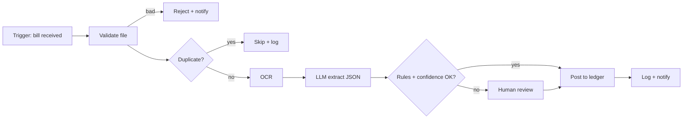

# 03 — SOP and Template Pack (copy, fill, file in `docs/`)

Every template below is a working form. Each states **who fills it**, **when**, and **what blocks the next gate if blank**. Money is INR excl. 18% GST unless stated; confirm the GST rate and place-of-supply treatment with your accountant.

---

## T1. Customer interview guide (Gate 1)

**Who:** Business Research Analyst or founder. **When:** before any design. **Target:** 10 interviews per product idea, 45 minutes each, recorded with consent.

| Block | Questions (ask in this order; do not pitch until block 6) |
|---|---|
| 1. Context | Role? Team size? Which software do you use daily? Who else touches this task? |
| 2. Current process | Walk me through the last time you did this, step by step. What triggered it? Where did the data come from? Where did it go? |
| 3. Volume and time | How many per week/month? Minutes each? Peak days? How many people? |
| 4. Errors and cost | How often is it wrong? What happens then? Last costly mistake? Who pays? |
| 5. Constraints | Who approves? Data you cannot share outside India or off-premise? Audit needs? Existing contracts? |
| 6. Value and budget | What would solving this be worth per month? What have you tried or paid for before? Who signs the purchase? |
| 7. Commitment test | Would you run a 4-week paid pilot at ₹X? If not, what would have to be true? |

**Scoring the interview (0–2 each):** pain is stated unprompted · volume is measurable · they spend money or time today · a buyer with budget is present · they accept a pilot. **≥7/10 = qualified lead.** Gate 1 needs ≥3 qualified leads from 10 interviews or the idea is shelved.

---

## T2. Process discovery sheet (Phase 2.1)

| Field | Content |
|---|---|
| Process name / ID | |
| Business objective (one measurable sentence) | e.g. "Post every supplier bill to Tally within 24 h with <0.5% errors" |
| Process owner / staff involved | |
| Trigger | event or schedule |
| Inputs (source, format, volume/month) | |
| Steps (numbered, with minutes each) | |
| Business rules | numbered, testable ("IGST xor CGST+SGST") |
| Decision points | condition → outcome |
| Exceptions and frequency | e.g. unreadable image 4%, missing GSTIN 2% |
| Output and destination system | |
| Approvals | who, threshold |
| Failure scenarios and current workaround | |
| Manual effort | minutes/item × items/month = hours/month |
| Data sensitivity | none / personal / financial / health |

**Quantify the baseline:** `Baseline cost/month = hours/month × loaded hourly cost + error rework cost`. Without this number Gate 9 ROI is fiction.

---

## T3. AS-IS / TO-BE workflow pack (Gate 2 and 6)

Required diagrams (Mermaid in `docs/workflow/`): (1) swimlane AS-IS, (2) swimlane TO-BE, (3) data-flow with PII marked, (4) system-integration diagram, (5) exception paths. Colour/label each TO-BE step as one of: **A** fully automated · **R** rule-based · **AI** AI-assisted · **H** human approval · **E** manual exception.

Bottleneck analysis table: step · minutes · wait time · error rate · automatable (Y/N/partly) · why.

---

## T4. Automation feasibility classification (Gate 3)

Answer in order and stop at the first "yes":

1. Is the input structured and the rule explicit? → **Rule-based / API automation**.
2. Is there an official API for every system touched? If not, is the UI stable and automation permitted by its terms? → **API-based**, else **RPA** (never bypass CAPTCHA or access controls).
3. Is one step unstructured (document, free text) but the surrounding flow fixed? → **AI-assisted workflow** (LLM step inside a deterministic flow).
4. Must answers come from private documents? → **RAG**.
5. Does the sequence of steps depend on intermediate findings and can tools be bounded? → **Tool-using agent**.
6. Are there truly independent responsibilities needing separate permissions or contexts? → **Multi-agent**.

Record: chosen class · rejected simpler class and why · what happens when the automation is wrong (impact: low/medium/high) · human-in-the-loop decision.

---

## T5. Input/output freeze document (Gate 4)

| Section | Required content |
|---|---|
| Inputs | source, format, required/optional fields, types, validation rules, auth, file size limit, sensitivity |
| Processing | trigger conditions, business rules (numbered), model and prompt version, tools/API calls, decision logic, confidence thresholds, retry conditions, escalation conditions |
| Outputs | format and JSON schema (versioned), destination, accuracy target per field, notification, report, audit trail, error response, approval requirement |
| Non-functional | latency target, throughput, availability, retention, locale, accessibility |
| Budget and timeline | frozen number and dates |
| Signatures | customer owner, PM, architect, with date |

**Change request form:** CR id · requester · description · reason · affected rules/integrations · extra hours (optimistic/expected/pessimistic) · extra ₹ · timeline impact · risk · decision · approver · date. Nothing is built from a CR until both parties sign.

---

## T6. Agent specification (Gate 5, only if an agent is justified)

| # | Field | Fill with |
|---|---|---|
| 1 | Objective | one bounded sentence |
| 2 | System instructions | versioned file |
| 3 | Tools + permissions | each tool: purpose, read/write, scope, rate limit |
| 4 | Input / output schema | JSON schema |
| 5 | Model | primary, fallback, why |
| 6 | Memory and context | what is kept, where, how long, how trimmed |
| 7 | Decision logic | when to stop, when to ask a human |
| 8 | Limits | max steps, max tokens, max ₹ per run, timeout |
| 9 | Retry / error policy | backoff, which errors are retryable |
| 10 | Human approval | list of actions that always need approval |
| 11 | Audit log | fields recorded per step |
| 12 | Retention | days, deletion method |
| 13 | Abuse cases | prompt-injection scenarios tested |

Forbidden: unrestricted email, payments, shell, database or customer-account access.

---

## T7. Evaluation plan (Gate 8)

1. **Dataset:** ≥300 real, authorised items for extraction; ≥100 per class for classification; ≥100 question/answer pairs with gold citations for RAG; stratify by difficulty; hold out 30% never used for prompt tuning.
2. **Metrics** (choose per use case, see `01` §7) with a **pass threshold agreed before testing**.
3. **Error taxonomy:** every miss labelled (OCR, prompt, rule gap, ambiguous source, label error).
4. **Regression:** run on every prompt/model/rule change; block release if any critical metric drops by more than the agreed tolerance.
5. **Report:** metric table, confusion cases, cost per successful task, top 10 failures, decision.

---

## T8. Security review checklist (Gate 5 and 8)

| Area | Check | Evidence |
|---|---|---|
| Prompt injection | Direct and document-embedded attacks cannot trigger tool actions | test log |
| Data leakage | Cross-tenant prompt and retrieval tests pass | test log |
| Tool permissions | Allowlist; least privilege; write tools need approval | config |
| Secrets | Manager used; none in git; rotated; separate per environment | scan |
| Webhooks | Signature verified; replay window; HTTPS only | test |
| Uploads | Type/size/magic-byte checks; malware scan; sandboxed parsing | test |
| Logging | PII masked; no secrets or full prompts with personal data | sample review |
| Access | Role-based; admin MFA; n8n editor not public | config |
| Spend/abuse | Per-tenant and per-run caps; alert at 80% | config |
| Data protection | Retention and deletion; processor agreement; breach procedure | document |
Reference: OWASP Top 10 for LLM Applications; OWASP agentic-AI guidance; NIST AI RMF. Verify current versions.

---

## T9. Risk register (live document)

`ID · risk · cause · likelihood (1–5) · impact (1–5) · score · mitigation · owner · trigger · status`. Seed risks for every project: model quality below target; provider outage or price change; customer data quality; scope creep; key-person dependency; duplicate external actions; prompt injection; support load above plan; customer not realising time savings.

---

## T10. Commercial documents

| Document | Contents that must be present |
|---|---|
| Proposal | customer problem in their numbers, TO-BE flow, results measured in pilot, limits, price table, timeline, assumptions |
| ROI report | baseline hours and cost, realisable-saving %, net benefit, payback, sensitivity (−30% volume) |
| Statement of Work | scope (frozen I/O), deliverables, acceptance criteria and test, customer responsibilities, change control, milestones and payments, assumptions, exclusions |
| Agreement | fees and GST, term and renewal, SLA and support hours, **data ownership (customer)**, **platform and prompt IP (vendor)**, customer-specific mappings licence, sub-processors, confidentiality, liability cap, termination and data return/deletion, governing law. **Lawyer review required.** |
| DPA | roles (fiduciary/processor under India's DPDP Act), purposes, retention, security measures, breach notice, sub-processor list incl. LLM provider |
| Onboarding guide | week-by-week plan (see `02` §19) |
| Integration checklist | credentials owner, scopes granted, test account, webhook URL, IP allowlist |
| User manual / admin manual / support doc | task-based, screenshots, error messages with fixes, escalation path |

Do not use customer credentials or data in demos without written authorisation. Use synthetic data for public demos.

---

## T11. Weekly status report (every project, every Friday)

Progress vs plan (%) · hours planned/actual/forecast · gates passed and next gate date · top 3 risks · decisions needed from customer · cost to date vs budget · next-week plan. One page.

---

## T12. Production readiness checklist (Gate 10)

☐ Separate prod credentials ☐ HTTPS and certificate renewal ☐ Webhook verification ☐ Idempotency tested ☐ Retries and dead-letter queue ☐ Spend caps ☐ Alerts routed to a person ☐ Backup taken **and restored in a drill** ☐ Rollback rehearsed ☐ Runbook written ☐ Audit log writes verified ☐ Prompt/model versions pinned ☐ Monitoring dashboard live ☐ Support owner named.

---

## T13. Monthly maintenance and cost review

| Metric | Source | Action threshold |
|---|---|---|
| Workflow success rate | run logs | <97% → incident review |
| Human-override rate | review UI | up 5 points → re-evaluate prompt |
| Cost per successful execution | cost model vs actual | >20% over plan → investigate |
| Token spend vs cap | provider dashboard | >80% cap → alert customer |
| Latency p95 | traces | above SLA → scale |
| Queue backlog | queue depth | growing 3 days → add workers |
| Duplicate actions | idempotency log | any → P1 |
| Customer complaints | tickets | trend up → success call |
Quarterly: model-upgrade test on the regression set, backup restore drill, dependency and security update, pricing review. **Never swap a production model or prompt without regression evaluation and approval.**

---

## T14. Stage-gate sign-off sheet

`Project · gate · date · evidence links · approver · decision (pass / pass with conditions / fail) · conditions · management waiver (if skipped, with reason and signature)`.

 
Developed by <b>V. LOKESHWARAN</b> · VEL Software Solutions · <a href="mailto:velsoftwaresolutions.in@gmail.com">velsoftwaresolutions.in@gmail.com</a>

