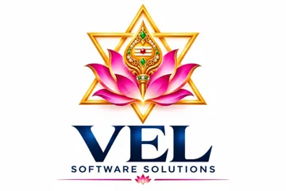

# 04 — Technology Selection, Competitor Map and Costing Reference

**Evidence status:** the comparisons below are qualitative and come from general knowledge, not live research (network to vendor sites was blocked). Columns marked **VERIFY** must be checked against the official page and dated before they are used in a proposal. No price or limit is stated here on purpose.

## 1. Competitor map (Phase 1.3)

| Vendor | Category | Strength | Typical limitation for us | Verify before use |
|---|---|---|---|---|
| Zapier | Hosted no-code integration | Largest app catalogue, fast to start | Per-task pricing grows with volume; hosted only; limited control of data residency | pricing, task limits, AI features, data terms |
| Make | Hosted visual automation | Strong branching/routing, cost-effective at mid volume | Hosted only; operation-based pricing; complex scenarios hard to version | pricing, operation limits, EU/India hosting |
| n8n | Workflow engine, source-available, self-hostable | Self-hosting, code nodes, AI nodes, version-exportable JSON | Licence limits reselling it as a service; you run and secure it | licence text, cloud pricing, queue-mode needs |
| Activepieces | Open-source automation | Permissive-licence core, self-hostable | Smaller connector catalogue | licence of the edition you deploy, connectors |
| Microsoft Power Automate | Enterprise iPaaS/RPA | Deep Microsoft 365 integration, desktop RPA | Per-user/per-flow licensing; Microsoft-centric | licensing tiers, premium connector costs |
| UiPath | Enterprise RPA | Mature RPA, governance | Heavy, expensive for SMEs | licensing, deployment options |
| Workato | Enterprise iPaaS | Enterprise governance and connectors | Enterprise pricing; not SME-friendly | pricing model |
| Accounting suites and GST tools | Vertical competitors | Built-in OCR, filing integration | Mostly tied to their own ecosystem; weak on WhatsApp/photo bills and multi-client CA workflows | feature lists per vendor |
| Manual process | Real alternative | Zero software cost | Errors, month-end peaks, staff cost | customer baseline (T2) |

**Positioning rule:** do not compete with Zapier/Make on connector count. Compete on a **finished, accountable outcome for one vertical** (e.g. "bills posted to Tally with a human review queue"), delivered with SLAs, audit trail and India-specific rules. Horizontal tools are our *components*, not our competitors, in custom projects.

## 2. Workflow platform selection (Phase 3.1)

| Option | Choose when | Avoid when |
|---|---|---|
| n8n self-hosted | Default for custom builds: control, code nodes, customer-readable flows | You plan to resell n8n itself as a hosted product without a commercial licence |
| Make / Zapier | Customer already owns it; very low volume; non-sensitive data | High volume, sensitive data, need for version control |
| Activepieces | Need a permissively licensed engine to embed | Needed connector is missing |
| Power Automate | Customer is Microsoft-365-centric | Cross-vendor stack, tight margins |
| Temporal | Long-running, durable, multi-step business processes with strict retry semantics | Simple event flows (adds operational weight) |
| Apache Airflow | Scheduled batch data pipelines | Event-driven, human-in-loop flows |
| Custom Python service | Core logic, rules engine, validations that must be unit-tested | Glue code that n8n already does |

**Decision criteria to score (1–5) per project:** self-hosting need · data sensitivity · execution volume · connector coverage · error handling and observability · version control · vendor lock-in · licence fit for resale · team skills · total cost at 10× volume.

## 3. AI model and framework selection (Phase 3.2)

Principle: **call the provider SDK directly first.** Add a framework only when it removes real work.

| Option | Use for | Watch out |
|---|---|---|
| Provider SDKs (Anthropic, OpenAI, Google Gemini) | Extraction, classification, summarisation with structured output | Provider lock-in: wrap behind one `LLMClient` interface |
| Hugging Face (open models) | On-premise/air-gapped needs, embeddings, cheap classification | You operate GPUs and safety yourself |
| LangChain | Many integrations, quick prototypes | Abstraction churn; verify current API stability |
| LangGraph | Explicit stateful agent graphs with checkpoints | Only if you truly need an agent |
| LlamaIndex | RAG ingestion and retrieval pipelines | Evaluate retrieval separately from generation |
| Semantic Kernel | .NET/C# shops | Smaller Python ecosystem |
| AutoGen / CrewAI | Multi-agent experiments | Verify maintenance status and licence now; avoid for production unless needed |

**Verify for every framework before selection:** current release and maintenance activity, licence, breaking-change history, observability support, and whether the provider SDK already does the job.

**Model selection procedure:** build the labelled set (T7) → run three tiers (economical, balanced, high-capability) → record accuracy, p95 latency, ₹ per successful task → choose the cheapest tier that meets the pre-agreed thresholds → define a fallback → pin the version → schedule re-evaluation before any provider model upgrade. Never assume tiers are equivalent in quality.

## 4. Data, messaging and language choices

| Need | Default | Alternative and when |
|---|---|---|
| Relational data, audit | PostgreSQL | MySQL if the customer mandates it |
| Vector search | pgvector inside Postgres | Dedicated vector DB only when scale or filtering demands it |
| Cache/queue | Redis | Cloud queue service when managed ops is cheaper |
| Documents | Object storage with encryption and lifecycle rules | |
| Local/dev | SQLite | never as n8n production DB |
| Language | Python for AI and services; TypeScript for dashboards and front ends | C# when integrating with a .NET estate |
| Integration | Official REST APIs, OAuth 2.0, signed webhooks | MQTT for device/IoT data; browser automation only as last resort |

## 5. Architecture selection summary

| Pattern | Cost drivers | Main risks |
|---|---|---|
| Simple workflow | Executions | Brittle rules |
| API integration | Provider rate limits | Credential renewal |
| Event-driven | Queue and workers | Duplicate delivery |
| AI-assisted workflow | Tokens, OCR | Wrong extraction reaches system (mitigated by validation and review) |
| RAG | Embeddings, vector storage, retrieval | Stale documents, access control leaks |
| Tool-using agent | Multiple model calls per task, variable length | Unbounded loops, unsafe actions |
| Multi-agent | Coordination tokens and latency | Complexity with no accuracy gain |
| Hybrid RPA + AI | Runner licences, maintenance | UI changes break bots |

## 6. Costing reference — every formula (Phase 8–9)

Implemented in `calculator/cost_model.py` with hand-calculated tests.

| Item | Formula |
|---|---|
| Token cost (USD) | `in_tokens/1e6 × in_price + out_tokens/1e6 × out_price` |
| AI cost per attempt (INR) | `[base × (1 + retry_rate) + escalation_rate × escalation_cost] × USD_INR` |
| Variable cost per attempt | AI + OCR pages × price + messages × price + other |
| Cost per successful execution | `variable ÷ (1 − failure_rate)` |
| Human review cost per execution | `review_minutes × review_rate × reviewer_hourly ÷ 60` |
| Monthly total | `infra + executions × (variable + review) + maintenance labour` |
| Dev labour | `Σ hours × loaded hourly cost`, then `× (1 + overhead)`; optimistic ×0.8, expected ×1.0, pessimistic ×1.4 |
| First-year cost | `one-time + 12 × monthly operating` |
| Project price | `(dev + third-party) × (1 + risk) ÷ (1 − target margin)` |
| Tier revenue | `monthly fee + max(0, executions − included) × overage` |
| Contribution margin | `revenue − cost to serve` (includes review and maintenance) |
| Customer ROI | `hours saved × staff rate × realisable % − subscription`; payback = `investment ÷ net monthly benefit` |
| LTV | `monthly contribution ÷ monthly churn` |
| Break-even customers | smallest N with operating profit ≥ 0 |

**Avoid double counting:** dev hours are in one-time cost only; maintenance hours are in monthly only; shared infrastructure is allocated per customer, not charged in full to each.

**Three production models** (choose by contract value, never by default):

| | Lean MVP | Professional | Enterprise |
|---|---|---|---|
| Infra | single VM, Compose, managed DB optional | managed Postgres, queue workers, monitoring, backups | HA, SSO, DR region, audit export |
| Fits | pilots, ≤ ~1k executions/mo | paying SMEs | contracts that fund redundancy |
| Limits | no redundancy; free tiers are not permanent production | | cost |
| Scale trigger | queue delay or CPU sustained high | per-tenant caps hit, p95 breach | contractual SLA |

**Pricing model fit:** pay-per-document suits invoice/bill processing; subscription with included volume suits assistants and lead flows; setup fee + subscription suits integrations needing onboarding; retainer suits bespoke systems; enterprise licence suits multi-site rollouts. Always define overage and an abuse policy; never promise unlimited AI.

## 7. Sensitivity checks to run before pricing (add to every project)

1. Volume −30% and +100%.
2. Model price ×2 and token use ×1.5.
3. Auto-approval rate 60% / 80% / 90% (drives review cost).
4. Support hours per customer ×0.5 and ×2.
5. Churn 3% / 6% / 10%.
6. Realisable saving 40% / 60% / 80%.
Record which assumption flips the decision; that assumption gets measured first in the pilot.

 
Developed by <b>V. LOKESHWARAN</b> · VEL Software Solutions · <a href="mailto:velsoftwaresolutions.in@gmail.com">velsoftwaresolutions.in@gmail.com</a>

