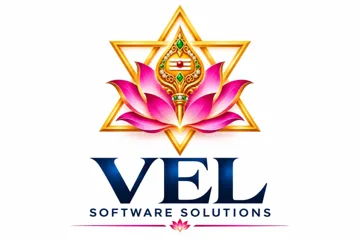

# 05 — People, Internal Portal and Support Model

## 1. Role charters

| Role | Mission | Owns | Produces | Escalates to |
|---|---|---|---|---|
| Founder / Product owner | Company outcomes | Gates 1, 9; pricing; hiring | Priorities, approvals, contracts | — |
| Business Research Analyst | Find validated problems | Market research, interviews | Opportunity report with scores and evidence | Founder |
| Automation Business Analyst | Capture the real process | T2, T3, T5 | AS-IS/TO-BE, frozen I/O, UAT scripts | Architect |
| AI Solutions Architect | Choose the simplest design that works | Gates 3, 5 | Architecture, agent spec, cost model inputs | Founder |
| AI Engineer | Make model steps reliable | Prompts, schemas, evals | Prompt versions, eval reports | Architect |
| Python / Backend Developer | Build services | Rules engine, APIs, adapters | Tested code, API docs | Tech lead |
| Workflow Automation Developer | Build and version flows | n8n flows, triggers, approvals | Exported workflow JSON | Tech lead |
| Frontend Developer | Review and admin UIs | Approval UI, dashboard | Accessible UI | Tech lead |
| API Integration Specialist | Integrations that stay working | Provider docs, scopes, webhooks | Integration registry entries | Architect |
| Data Engineer | Data quality and pipelines | Ingestion, storage, retention | Schemas, pipelines | Architect |
| QA and AI-Eval Engineer | Prove quality | Gate 8, regression sets | Test and eval reports | Founder |
| DevOps Engineer | Reliable production | Gate 10, backups, alerts | IaC, runbooks | Founder |
| Cybersecurity Specialist | Reduce abuse and leakage | T8, secrets, pen-tests | Security report | Founder |
| Sales Executive | Qualified pipeline | Proposals, demos | Pipeline, signed SOW | Founder |
| Customer Success Executive | Adoption and retention | Gates 11–12, QBRs | Health scores, renewals | Founder |

**Small-team combinations:** 1 person = Founder+Architect+AI engineer (build) with contractors for QA/security reviews. 3 people = Founder/Sales · Architect/AI · Developer/DevOps. 6 people adds QA-Eval, Customer Success, second developer.

## 2. RACI by gate (R = does, A = accountable, C = consulted, I = informed)

| Gate | Founder | Architect | Dev | QA | DevOps | Security | CS | Customer |
|---|---|---|---|---|---|---|---|---|
| 1 Market | A | C | | | | | | C |
| 2 Process | I | R | | | | | | A |
| 3 Feasibility | I | A/R | C | | | | | I |
| 4 Scope freeze | A | R | C | | | | | A |
| 5 Architecture | I | A/R | C | | C | C | | I |
| 6 Workflow/UI | I | C | R | | | | | A |
| 7 Dev review | I | A | R | C | | | | |
| 8 AI/security | I | C | C | A/R | | R | | |
| 9 Pricing | A/R | C | | | | | | |
| 10 Deploy | A | C | C | C | R | C | I | I |
| 11 Acceptance | I | | | C | | | R | A |
| 12 Handover | I | C | | | C | | A/R | I |

## 3. Per-project record fields (`project.yaml`)

`project_id, customer, customer_owner, project_manager, technical_lead, business_owner, budget_inr, scope_version, assigned[], hours{planned,actual,forecast}, production_cost{one_time,monthly}, selling_price{setup,monthly}, expected_margin, timeline{start,gates[],go_live}, stage, risks[], change_requests[]`.

## 4. Internal portal specification (Phase 14)

**Build rule:** earn each module. Start with spreadsheets/Notion, build a module only when the manual version causes repeated error or delay.

| Priority | Module | Core data | Key screen |
|---|---|---|---|
| P1 | Project register + gates | project record, gate sign-offs, risks | pipeline board by stage |
| P1 | Cost / token / API / pricing / ROI calculators | `pricing_inputs.json` with source URL, verified flag and date | what-if panel with sensitivity |
| P2 | AI model registry, prompt versions, eval results | model, version, price, eval scores | compare runs side by side |
| P2 | Workflow and API integration registry | exported flows, scopes, rate limits, renewal dates | integration health |
| P2 | Deployment and maintenance tracker | environments, versions, backups, last restore drill | readiness checklist |
| P3 | Usage analytics per customer | executions, success rate, ₹ per success | cost vs plan |
| P3 | Customer and sales pipeline | accounts, deals, contracts | funnel |
| P3 | Financial reports | MRR, ARR, margin, retention | board pack |

**Dashboard metrics:** total projects; active and completed automations; workflow success rate; failed executions; average duration; AI spend; API spend; monthly production spend; cost per successful execution; customer savings; MRR; gross margin; retention; pending approvals.

**Access control:** roles (founder, architect, developer, QA, support, sales, finance, read-only). Sales cannot see customer data; support sees masked data; secrets are never rendered, exported or logged; every view of customer data is audit-logged.

## 5. Support model and maintenance pricing

| Level | Handled by | Examples | Target response (set per contract) |
|---|---|---|---|
| L1 | Customer Success | How-to, user access, report requests | same business day |
| L2 | Developer | Failed runs, integration errors, rule changes | 4 business hours (P1: 1 hour) |
| L3 | Architect / AI engineer | Model drift, prompt redesign, new document types | planned |

Severity: **P1** automation posting wrong data or stopped for all users; **P2** one workflow degraded; **P3** cosmetic or request.

Maintenance retainer builds from the cost model: `hours per month × loaded rate + monitoring + allocation of infra + margin`. For the sample, 6 developer hours and 8 support hours cost ₹7,400 per customer per month at placeholder rates, which is why support efficiency (runbooks, self-service, auto-triage) is the main profitability lever. Charge change requests and new document types separately.

## 6. Weekly and monthly operating rhythm

| When | Meeting / report | Output |
|---|---|---|
| Monday | Planning, 30 min | priorities, capacity |
| Daily | Failed-run triage, 15 min | incident list |
| Friday | Status report (T11) per project | one-pager |
| Monthly | Cost and quality review (T13) | actions, pricing changes |
| Quarterly | Security, model, backup-restore review | roadmap update |

 
Developed by <b>V. LOKESHWARAN</b> · VEL Software Solutions · <a href="mailto:velsoftwaresolutions.in@gmail.com">velsoftwaresolutions.in@gmail.com</a>

