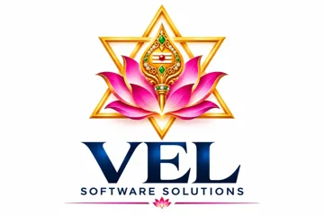

# AI Automation Engineering Department — Operating System

Separate from the WPF "AI Building Studio" project in this repo.

| File | Purpose |
|---|---|
| `00-intake-and-assumptions.md` | Intake answers, assumptions to confirm, opportunity ranking |
| `01-operating-framework.md` | 12 gates, tech-selection rules, workflow standard, roles, security, deployment, maintenance, portal build order |
| `02-sample-lifecycle-gst-bill-automation.md` | Full 24-stage lifecycle with costs, pricing, ROI, break-even |
| `03-sop-and-template-pack.md` | 14 fill-in templates: interview guide, process sheet, feasibility, I/O freeze, agent spec, eval plan, security checklist, risks, commercial docs, status, readiness, maintenance, sign-off |
| `04-technology-competitors-and-costing-reference.md` | Competitor map, platform/framework/model selection, every costing formula, sensitivity checks |
| `05-people-portal-and-support.md` | Role charters, RACI by gate, portal spec, support levels, operating rhythm |
| `calculator/` | `cost_model.py` + golden tests, `pricing_inputs.json`, `report.py`, `sensitivity.py`, `opportunity_score.py` |

Run: `cd calculator && pip install pytest && python -m pytest -q && python report.py`

**Pricing status: UNVERIFIED.** Provider/vendor pricing could not be fetched (network allowlist). `assert_quotable()` raises until every price input is verified from its official source.

---

 
Developed by <b>V. LOKESHWARAN</b> · VEL Software Solutions · <a href="mailto:velsoftwaresolutions.in@gmail.com">velsoftwaresolutions.in@gmail.com</a>

