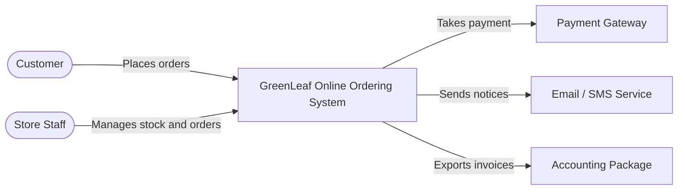

# Software Architecture & Consulting Handbook

From zero to professional: training, consulting lifecycle, governance, documentation, costing and client delivery

# How to Use This Handbook

This handbook is the single operating manual for the **Software Architecture & Technical Consulting Department**. It does two jobs: **(1)** it trains a beginner into a professional who can support client projects under senior architectural supervision, and **(2)** it defines the mandatory 15-stage consulting lifecycle, with owners, reviewers, approval gates and deliverable standards.

> **Golden rules of the department** — (1) Architecture is a set of **decisions with reasons**, not a set of diagrams. Every diagram must trace to a requirement and every significant choice to an ADR.; (2) Never present an unverified assumption as a confirmed client fact. Label it **ASSUMPTION** with an owner and a date to confirm.; (3) Do not recommend a pattern or technology because it is popular. Compare at least two viable options and write down the trade-offs.; (4) Juniors prepare research, documentation and diagrams. Juniors **never** approve high-impact decisions.; (5) We never certify a client as "secure" or "compliant" and never guarantee uptime, savings or performance without evidence. We offer readiness support and *reasoned recommendations*.; (6) Prices, tool versions, standards editions and cloud limits change. Verify against the official source before you build, quote or cite.; (7) Every approved architecture decision needs a second person's review. No one reviews their own work.

## Reading path for a beginner

Part A: Onboard (Ch. 10-11) → Part B: Learn Levels 1-7 (Ch. 3-5) → Part C: Lifecycle (Ch. 6-8) → Part D: Business (Ch. 2, 9) → Part E: Projects and sources (Ch. 13-14)

> **About the examples** — Client names such as **GreenLeaf Organics** are fictional training examples. Prices are illustrative defaults for training, not quotes. Replace them with approved company rates before use.

> **Document status** — Document VEL-SA-001 · Version 1.0 · prepared 4 November 2026 · draft for management approval. Standards and tool facts in this handbook were written from the author's knowledge; the official links in Chapter 14 could not be machine-checked in the build environment, so open each one and confirm the current edition before relying on it.

# Commercial Service Portfolio

Eighteen commercially deliverable services. Each can be sold alone or combined. Every service ends in a **reviewed written deliverable**, never only a conversation.

| Service | What we deliver | Typical client trigger |
|---|---|---|
| Software architecture consulting | Independent advice on structure, patterns and risks for a new or existing system | "We are about to build and want it right." |
| Solution architecture | End-to-end design of one solution across apps, data, integration and infrastructure | "We need a design before we hire developers." |
| Enterprise architecture advisory | Capability maps, target state, standards and roadmaps across many systems | "We have 40 systems and no shared direction." |
| Technical feasibility studies | Evidence-based yes/no/with-conditions on technology, cost, skills, time and compliance | "Can this even be done within budget?" |
| Technology selection | Weighted comparison of languages, frameworks, databases, platforms | "Which stack should we choose?" |
| Application architecture reviews | Structured review against quality attributes; findings and fixes ranked by risk | "It works but nobody dares change it." |
| Cloud architecture design | Landing zone, network, compute, data, DR and cost design on AWS / Azure / GCP | "Move us to the cloud without surprises." |
| Database architecture | Logical and physical models, engine choice, scaling, backup and migration | "Reports take minutes; data is inconsistent." |
| API architecture | REST/event API style, contracts (OpenAPI), versioning, security, governance | "Partners integrate in ten different ways." |
| Microservices assessment | Is a split justified? Boundaries, data ownership, operational readiness | "Everyone says we need microservices." |
| Monolith modernisation | Incremental path (modular monolith, strangler pattern) with risk-ranked steps | "Release takes 3 weeks and breaks things." |
| Legacy system assessment | Inventory, risk, cost-of-ownership, retire / retain / rehost / refactor / replace | "The only developer who knows it is leaving." |
| System integration architecture | Integration patterns, canonical data, error handling, monitoring | "Systems disagree and re-key data by hand." |
| Security architecture coordination | Trust boundaries, threat model, control mapping; coordinates with security specialists | "A customer asked about our security." |
| Scalability and performance reviews | Load model, bottleneck analysis, capacity plan, test strategy | "Black Friday took us down." |
| Technical due diligence | Independent assessment of a target's technology, debt, team and risk for investors | "We are acquiring / investing; what are we buying?" |
| Architecture documentation | C4 diagrams, ADRs, interface specs, runbooks and handover packs | "No one knows how it fits together." |
| Digital transformation roadmaps | Phased, costed roadmap tying business goals to technology change | "Leadership wants a 3-year plan." |

> **Compliance and assurance wording** — We say "security architecture coordination" and "compliance readiness support." We do not certify, audit-opine or guarantee. Formal certification (for example ISO/IEC 27001) is performed by accredited bodies. Technical due diligence reports state their scope and evidence limits.

# Department Structure and Roles

A junior employee may prepare research, documentation and diagrams but **must not independently approve high-impact architecture decisions**. High-impact means any decision that is costly to reverse, affects security or data protection, changes cost by more than 10%, creates vendor lock-in, or touches more than one team.

| Role | Core responsibilities | Decision authority | Typical entry |
|---|---|---|---|
| Junior Technical Analyst | Research, notes, diagrams, documentation, draft ADRs, comparison tables | Prepares only. Cannot approve architecture decisions or send client advice unreviewed. | Months 0-12 |
| Business Analyst | Stakeholder interviews, process maps, requirements, acceptance criteria, traceability | Owns the requirements baseline; signs requirement completeness. | Level 2 mastered |
| Solution Architect | End-to-end design for one engagement; alternatives, target architecture, handover | Approves medium-impact design; proposes high-impact decisions. | Level 5 mastered |
| Software Architect | Application structure, patterns, code-level standards, API and data design | Approves application-level design; reviews implementation compliance. | Level 4-5 |
| Cloud Architect | Cloud landing zone, networking, DR, cost, IaC standards | Approves cloud design and cost model. | Level 5 + cloud certs advised |
| Security Architect | Threat models, trust boundaries, control mapping, security review | Veto on unresolved high security risks; signs security section. | Level 5-6 |
| Enterprise Architect | Cross-system capability maps, standards, roadmaps, governance | Approves cross-programme direction and standards. | Level 7 |
| Principal Architect | Department technical authority, review board chair, due-diligence sign-off | Final approval of high-impact decisions and client-facing architecture. | Senior |
| Project Manager | Scope, schedule, budget, risks, change control, client communication | Approves scope change and commercial terms with the sponsor. | Any |

*Figure: **Figure 2.1** Approval authority grows with seniority.*

## Decision-impact matrix

| Impact | Examples | Who may approve |
|---|---|---|
| Low | Diagram styling, naming, tool template choice | Any architect or the author's reviewer |
| Medium | Library choice, module boundaries, API style within an approved architecture | Solution or Software Architect |
| High | Database engine, cloud provider, monolith vs microservices, security model, DR strategy, any commitment above 10% cost change | Principal Architect plus client sponsor; recorded as an ADR |

## RACI for a standard engagement

R = does the work · A = accountable and approves · C = consulted · S = supports · I = informed.

R = does the work · A = accountable and approves · C = consulted · S = supports · I = informed.

# Learning Roadmap: Levels 1-7

For **every** subject the trainee receives the 15-part teaching pack (Chapter 12). The tables below are the syllabus. A level is passed only when all exercises are demonstrated and reviewed by a Principal or Solution Architect.

## Level 1 — Software Fundamentals (weeks 1-2)

| Topic | Simple definition | Why it matters | Exercise and check |
|---|---|---|---|
| Software lifecycle | The stages software passes through: idea, requirements, design, build, test, release, operate, retire. | Architecture decisions are cheapest at the start and costliest after release. | Map a recent app you use to the lifecycle stages. |
| Requirements | A statement of what the system must do or be. | Wrong requirements produce the right system for the wrong problem. | Rewrite 5 vague wishes as testable requirements. |
| Frontend and backend | Frontend runs on the user's device; backend runs on servers and holds rules and data. | Security checks must live in the backend; the browser can be tampered with. | Open browser dev tools; identify requests the page makes. |
| Databases | Organised, durable storage with rules for access. | Data outlives code; bad data design is the hardest to fix. | Design two related tables (customer, order); explain the key. |
| APIs | A contract by which one program asks another to do something. | APIs are how systems integrate; changing them breaks others. | Call a public API with Postman; read the status code and JSON. |
| Servers | Computers (physical or virtual) that run software 24x7. | Capacity, location and failure of servers drive availability. | List what happens if the only server loses power. |
| Networks | How devices exchange data: IP, DNS, ports, HTTP/S, firewalls. | Most "the site is down" faults are network faults. | Trace DNS for a domain with nslookup/dig; explain each answer. |
| Cloud fundamentals | Renting compute, storage and services on demand (IaaS, PaaS, SaaS). | Cloud shifts cost from capital to operating and changes failure modes. | Compare IaaS/PaaS/SaaS for hosting a website; give one example each. |
| Security fundamentals | Confidentiality, integrity, availability; authentication vs authorisation. | Security is a design property, not a patch. | Explain CIA triad using an online bank example. |

## Level 2 — Business Analysis (weeks 3-4)

| Topic | Simple definition | Why it matters | Exercise and check |
|---|---|---|---|
| Stakeholder identification | People who affect or are affected by the system. | Missing one stakeholder is the commonest cause of late rework. | Build a power/interest grid for the GreenLeaf case. |
| Discovery interviews | Structured conversations to learn goals, pain and constraints. | Clients describe solutions; we must uncover problems. | Run a 30-minute mock interview with the questionnaire (Appendix C). |
| Business objectives | Measurable outcomes the organisation wants. | Architecture is justified by objectives, not technology taste. | Turn "grow online" into 3 measurable objectives. |
| Functional requirements | What the system does (features, rules, data). | Basis for scope, estimates and tests. | Write 10 requirements in "The system shall..." form with IDs. |
| Non-functional requirements | How well it does it: performance, availability, security, etc. | NFRs drive architecture more than features do. | Give each NFR a number: "p95 < 500 ms at 200 users". |
| Business process mapping | Diagram of how work flows today and tomorrow. | Reveals manual steps and hand-offs that systems must support. | Draw order-to-delivery as a swimlane. |
| User journeys | A user's steps, thoughts and pain points to reach a goal. | Surfaces missing features and failure paths. | Map the checkout journey including a failed payment. |
| Constraints | Fixed limits: budget, date, skills, law, existing systems. | Constraints rule options out early. | List 8 constraints; mark each confirmed or assumed. |
| Risks | Uncertain events that could harm objectives. | Unmanaged risk becomes schedule and cost overrun. | Score 6 risks on likelihood x impact with owners. |
| Acceptance criteria | Testable conditions that define "done". | Prevents disputes at handover. | Write Given/When/Then for 3 requirements. |

## Level 3 — Software Architecture Fundamentals (weeks 5-6)

| Topic | Simple definition | Why it matters | Exercise and check |
|---|---|---|---|
| Architecture vs design | Architecture = significant, hard-to-change decisions; design = detail inside them. | We spend review time where change is costly. | Classify 10 decisions as architectural or design, with reasons. |
| Components and modules | Replaceable parts with a clear responsibility. | Enable parallel work and change isolation. | Split a food-ordering app into modules. |
| Interfaces and dependencies | The agreed surface between parts; who needs whom. | Most failures happen at boundaries. | Draw a dependency graph; find a cycle and fix it. |
| Separation of concerns | Each part handles one kind of thing. | Makes change local and testing simple. | Refactor a "god class" description into 4 concerns. |
| Coupling and cohesion | Coupling: how much parts depend on each other. Cohesion: how related a part's content is. | Aim for low coupling, high cohesion. | Score two designs for coupling; justify. |
| Layered architecture | Stack of layers; each uses the one below. | Simple, well understood; default for many business apps. | Draw the three-tier diagram (Chapter 11). |
| Modular monolith | One deployable unit with strict internal module boundaries. | Often the best starting point; cheap to run. | Define module boundaries and allowed dependencies. |
| Microservices | Independently deployable services owning their data. | Gives team autonomy; costs distribution complexity. | Complete Training Project 4 (comparison). |
| Event-driven systems | Parts communicate by publishing and reacting to events. | Decouples producers from consumers. | Model "order placed" with 3 consumers; list failure cases. |
| Distributed systems | Systems spread over networked machines that can fail independently. | Network is unreliable; consistency, latency and failure must be designed. | Explain CAP trade-off with a shopping-cart example. |

## Level 4 — Architecture Patterns (weeks 7-8)

| Topic | Simple definition | Why it matters | Exercise and check |
|---|---|---|---|
| See Chapter 4 | Ten patterns with benefits, costs, complexity and trade-offs. | Patterns are tools; wrong tool = wasted money. | For each pattern, write one situation where you would NOT use it. |

## Level 5 — Technical Architecture (weeks 9-10)

| Topic | Simple definition | Why it matters | Exercise and check |
|---|---|---|---|
| Application architecture | Structure of the software: layers, modules, runtime. | Determines change cost. | Produce C4 L2-L3 for the case study. |
| Database architecture | Data model, engine, replication, backup, scaling. | Data is the longest-lived asset. | Design ERD + backup plan (Project 3). |
| API architecture | Style (REST, events), contracts, versioning, auth. | Governs integration cost. | Write an OpenAPI skeleton (Project 5). |
| Integration architecture | How systems exchange data reliably. | Prevents re-keying and silent data loss. | Design retry + dead-letter handling. |
| Cloud architecture | Regions, zones, compute, storage, managed services. | Drives availability and cost. | Complete Project 6. |
| Network architecture | Subnets, routing, gateways, firewalls, DNS. | Limits blast radius of attack. | Draw the network diagram with trust zones. |
| Security architecture | Identity, encryption, trust boundaries, logging. | Required for client trust. | STRIDE-analyse one data flow. |
| Deployment architecture | How software reaches and runs in environments. | Determines release risk. | Describe dev/test/prod and promotion steps. |
| Monitoring architecture | Logs, metrics, traces, alerts, dashboards. | You cannot operate what you cannot see. | Choose 5 golden signals and alert thresholds. |
| Disaster recovery | Plan to restore service after major failure (RTO/RPO). | Backups untested are hopes. | Define RTO/RPO for 3 tiers of system. |

## Level 6 — Architecture Evaluation (weeks 11-12)

| Topic | Simple definition | Why it matters | Exercise and check |
|---|---|---|---|
| Quality attributes | Scalability, availability, reliability, performance, security, maintainability, interoperability, portability. | These are the criteria for judging alternatives. | See evaluation table in Chapter 4. |
| Cost and complexity | Total cost of ownership, plus cognitive and operational complexity. | Cheap to build can be costly to run. | Compute 3-year TCO for two options. |
| Vendor lock-in | Cost of leaving a provider or product. | Affects negotiating power and risk. | Rate lock-in 1-5 and write an exit plan. |
| Operational capability | Whether the client can actually run the design. | A brilliant design nobody can operate fails. | Skills-gap table for the client team. |

## Level 7 — Architecture Governance (weeks 13+)

| Topic | Simple definition | Why it matters | Exercise and check |
|---|---|---|---|
| Architecture Decision Records | Short documents capturing one decision, context, options and consequences. | Preserve the "why". | Write ADR-001 (Project 7). |
| Technical standards | Approved defaults (languages, patterns, naming, security baselines). | Reduce variation and review cost. | Draft a 1-page API standard. |
| Review boards and design reviews | Scheduled expert review of designs. | Catches high-impact flaws early. | Run a mock design review with a checklist. |
| Change management | Controlled handling of changes to scope and architecture. | Stops silent drift. | Process one change request end to end. |
| Technical debt | Accumulated shortcuts that raise future cost. | Must be visible and managed. | Create a debt register with interest and priority. |
| Architecture compliance | Checking implementation matches approved design. | Closes the loop from design to delivery. | Perform a compliance review on a sample repo. |
| Documentation lifecycle | Create, review, publish, update, retire documents. | Stale documents mislead. | Define owners and review cadence for each artefact. |

# Architecture Patterns and Evaluation

Explain **benefits, costs, complexity and trade-offs** of every pattern. **Do not recommend a pattern because it is popular.** A pattern is justified only by a requirement it satisfies better than the simpler alternative.

> **The simplicity test** — Before proposing any pattern, ask: (1) which requirement does it serve? (2) what is the simplest option that could meet it? (3) what new failure modes and skills does it add? (4) can the client team operate it? If you cannot answer all four, do not propose it.

| Pattern | What it is | Benefits | Costs / trade-offs | Complexity | Use when | Avoid when |
|---|---|---|---|---|---|---|
| MVC / MVP / MVVM | Separates data (model), screen (view) and input handling (controller). | Clear UI structure; testable logic; widely known. | Controllers can bloat; not a whole-system architecture. | Low | Server-rendered web apps, desktop apps. | Systems whose complexity is in the domain rules, not the UI. |
| Layered / N-tier | Presentation, business, data layers each using the one below. | Simple; easy onboarding; fits CRUD. | Can become a "big ball" with leaky layers; changes ripple vertically. | Low | Typical business apps, first version. | Highly independent scaling needs per feature. |
| Clean Architecture | Concentric rings; dependencies point inward to business rules. | Framework-independent core; testable; long-lived. | More files and mapping code; learning curve. | Medium | Long-lived, rule-heavy systems. | Short-lived prototypes or simple CRUD. |
| Hexagonal (ports and adapters) | Core exposes ports; adapters connect UI, DB, services. | Swap infrastructure easily; test core in isolation. | Indirection; discipline needed. | Medium | Many integrations; need testability. | Tiny apps where indirection exceeds value. |
| Domain-Driven Design | Model software around the business domain with bounded contexts. | Shared language with business; sound boundaries. | Needs domain experts' time; heavy for simple domains. | High | Complex domains; many teams. | Simple data entry systems. |
| Repository pattern | Abstraction over data access as a collection. | Decouples logic from storage; testable. | Can be redundant over modern ORMs; leaky abstractions. | Low | When storage may change or tests need fakes. | Where the ORM already gives the same abstraction. |
| CQRS | Separate models for commands (writes) and queries (reads). | Optimise reads and writes independently; clearer intent. | Two models to maintain; eventual consistency if stores split. | High | Read-heavy vs write-heavy asymmetry; reporting needs. | Plain CRUD with similar read/write shapes. |
| Event sourcing | Store every state change as an event; derive state by replay. | Full audit trail; time travel; rebuild projections. | Steep learning; event versioning; query complexity. | Very high | Audit-critical domains (finance, ledgers). | Most business apps; a normal audit table suffices. |
| Message-driven architecture | Components communicate via asynchronous messages through a broker. | Loose coupling; load levelling; resilience to downtime. | Debugging; ordering and duplicates; broker operations. | Medium-High | Spiky load; long tasks; integration. | Simple request/response needing immediate answers. |
| API gateway | Single entry point handling routing, auth, rate limits. | Central security and policy; hides internals. | Single point of failure and bottleneck if poor; extra hop. | Medium | Many services/clients; public APIs. | One small app with one client. |
| Backend-for-frontend (BFF) | A backend tailored to each client type (web, mobile). | Client-specific payloads; independent evolution. | More services; duplicated logic. | Medium | Distinct client needs. | One client type. |

*Figure: **Figure 4.1** Hexagonal architecture (ports and adapters).*

*Figure: **Figure 4.2** Modular monolith versus microservices.*

*Figure: **Figure 4.3** Event-driven architecture.*

## Monolith or microservices? Decision guide

| Question | Points to modular monolith | Points to microservices |
|---|---|---|
| Team size | Under ~15 engineers or one team | Many autonomous teams |
| Release independence | Releases can be coordinated | Teams must deploy independently |
| Scaling | Load is uniform | Specific parts need very different scaling |
| Domain knowledge | Boundaries still unclear | Boundaries are stable and well known |
| Operations maturity | Little DevOps experience | CI/CD, observability and on-call already mature |
| Consistency | Needs strong transactions across features | Eventual consistency acceptable |

> **Default advice** — For most clients, start with a **modular monolith** and extract services only where a measured need exists. State this reasoning in the ADR so the decision survives later fashion changes.

## Architecture evaluation criteria (Level 6)

| Attribute | Ask | Evidence / measure |
|---|---|---|
| Scalability | Can it handle 10x load by adding resources? | Load test; bottleneck analysis; capacity model |
| Availability | What % uptime is needed and what is the failure domain? | Target SLO (e.g. 99.9% = about 8.8 h downtime/year); redundancy design |
| Reliability | Does it behave correctly under faults? | Failure-mode analysis; retry/timeout design; chaos tests |
| Performance | Response time and throughput at expected load? | p95/p99 latency targets; profiling |
| Security | Which threats are mitigated and which accepted? | Threat model; control mapping; test reports |
| Maintainability | How costly is a typical change? | Module coupling; test coverage; change lead time |
| Interoperability | Can it exchange data with required systems? | Open standards; contract tests |
| Portability | Can it move between hosts/clouds? | Containers; standard interfaces; exit cost |
| Cost | Build + run + change cost over 3 years? | TCO model; cloud calculator |
| Complexity | How many moving parts and skills required? | Component count; skills matrix |
| Vendor lock-in | Cost and time to leave? | Proprietary service inventory; exit plan |
| Operational capability | Can the client run and support it? | Skills gap; runbooks; on-call model |

> **Availability numbers** — 99.9% availability allows about 8.76 hours of downtime per year (0.001 x 8,760 h). 99.99% allows about 52.6 minutes. Calculate, show the formula, and never promise a number the design and budget cannot support.

# Tools and When to Use Each

Choose the tool for the **audience and the artefact**. Diagram-as-code is best for version control and review; visual editors are best for workshops and stakeholder polish.

| Tool | Best for | Strengths | Watch out for | Licence / cost* |
|---|---|---|---|---|
| draw.io (diagrams.net) | Network, deployment, cloud and free-form diagrams | Free; large icon libraries; stores .drawio/.svg in Git | Layout drift; no semantic model | Open source, free |
| PlantUML | Sequence, class, component, C4 (via C4-PlantUML) | Text-based, diff-friendly; powerful | Syntax learning; automatic layout limits | Open source (verify edition) |
| Mermaid | Flowcharts, sequence, ER, simple C4 in Markdown | Renders natively in GitHub/GitLab Markdown | Limited layout control; C4 is experimental | Open source, MIT |
| C4 model | Notation to describe software at 4 zoom levels | Shared vocabulary for technical and business readers | Is a method, not a tool; keep levels consistent | Free to use (c4model.com) |
| Structurizr (DSL / Lite) | One model, many C4 views | Model-based consistency; DSL in Git | Hosted-service availability and pricing change: verify | DSL/Lite open source; check hosted plans |
| Figma / FigJam | Client presentations, workshops, visual polish | Collaboration; beautiful slides | Not source-controlled; not a model | Freemium; paid plans |
| GitHub | Version control, reviews, ADRs, docs-as-code, issues | Pull-request review; Actions; Markdown rendering | Do not store secrets or client confidential data in public repos | Free and paid plans |
| VS Code | Editing Markdown, PlantUML, Mermaid, IaC, API specs | Extensions; Git integrated; live preview | Extension trust and licences | Editor free |
| Cloud architecture tools | Vendor reference diagrams, cost calculators, well-architected tools | Official icons and patterns | Vendor bias; prices change | Calculators free |
| Threat modelling tools | STRIDE analysis, data-flow threat lists (OWASP Threat Dragon, Microsoft Threat Modeling Tool) | Structured threat discovery | Output needs expert review | Check each tool's licence |
| Database modelling tools | ERDs and schema design (dbdiagram, pgModeler, MySQL Workbench, draw.io) | Generates SQL; visual relations | Model drift from live schema | Varies; verify |
| Postman | Exploring and documenting APIs; collections; mock servers | Quick testing; sharing collections | Account/team limits; secrets in collections | Freemium |
| Terraform (documentation) | Reading and writing IaC, reviewing plans | Declarative infrastructure; large provider docs | Licence changes: evaluate OpenTofu; verify current terms | Check licence |
| Architecture documentation platforms | arc42 templates, MkDocs, Docusaurus, Confluence, Notion | Search, structure, publishing | Documents rot without owners | Varies |

*Licences and prices change. Verify on the vendor's official site and record the check date in the project's tool register.

## Which diagram for which question?

| Question to answer | Diagram | Audience | Preferred tool |
|---|---|---|---|
| What is the system and who/what uses it? | C4 Level 1 System Context | Everyone, including executives | Structurizr, PlantUML, draw.io |
| What deployable parts exist? | C4 Level 2 Container | Technical leads, ops, security | Structurizr, PlantUML |
| How is one container structured? | C4 Level 3 Component | Developers | PlantUML, Mermaid |
| Where does it run? | Deployment diagram | Cloud, ops, security | draw.io |
| How does data move and where are the trust boundaries? | Data-flow diagram | Security, data protection | draw.io, Threat Dragon |
| How do these steps interact over time? | Sequence diagram | Developers, integration partners | Mermaid, PlantUML |
| How is data structured? | Entity-relationship diagram | Developers, DBAs | dbdiagram, draw.io, Mermaid |
| How is the network segmented? | Network diagram | Network, security, ops | draw.io |
| What does the client approve? | Presentation deck | Executives | Figma, slides |

# Mandatory Consulting Lifecycle (15 Stages)

Every engagement follows these 15 stages in order. Each stage lists its **procedure, checklist, output, owner, reviewer and approval criteria**. A stage closes only when its approval criteria are met and recorded. Do not start the next stage early; if the client insists, record the risk and get Principal Architect approval.

*Figure: **Figure 6.1** The 15-stage consulting lifecycle in three phases.*

| Stage | Output | Owner | Reviewer |
|---|---|---|---|
| 01 Lead Qualification | Lead qualification record and opportunity assessment | Sales / Project Manager | Principal Architect |
| 02 Discovery | Discovery notes, stakeholder map, open-questions log | Business Analyst | Solution Architect |
| 03 Current-State Assessment | Current-state architecture document and inventories | Junior Technical Analyst (draft) / Solution Architect | Principal Architect |
| 04 Problem Definition | Problem statement and risk/impact summary | Solution Architect | Principal Architect |
| 05 Requirements Definition | Requirements specification (Appendix E) | Business Analyst | Solution Architect + client owner |
| 06 Feasibility Assessment | Technical feasibility report (Appendix F) | Solution Architect | Principal Architect |
| 07 Architecture Alternatives | Options paper and comparison matrix | Solution Architect | Principal Architect |
| 08 Target Architecture | Target-state architecture and threat model | Solution Architect with Cloud/Security Architects | Principal Architect |
| 09 Architecture Documentation | Architecture documentation pack | Junior Technical Analyst (draft) / Architects | Principal Architect |
| 10 Cost and Risk Analysis | Cost estimate (Appendix K) and risk register | Solution Architect / Cloud Architect | Project Manager + Principal Architect |
| 11 Client Presentation | Presentation and minutes | Solution Architect | Principal Architect |
| 12 Approval | Signed architecture approval record | Principal Architect | Client sponsor + ARB chair |
| 13 Engineering Handover | Handover pack and acknowledgements | Solution Architect | Engineering leads |
| 14 Architecture Governance | Governance reports and updated ADRs | Software / Solution Architect | Principal Architect / ARB |
| 15 Post-Implementation Review | Post-implementation review report | Solution Architect | Principal Architect |

## Stage 01 — Lead Qualification

**Objective:** Decide whether the client is a good fit before spending engineering time.

**Procedure**

1. Record organisation, industry, size, systems and business objective in the lead form.
2. Hold a 30-minute qualification call with the decision-maker.
3. Check fit with our services, conflicts of interest, budget range and timeline.
4. Score the opportunity (fit, risk, red flags); record unknowns with owners.

**Checklist**

- [ ] Decision-maker identified
- [ ] Business problem stated in the client's words
- [ ] Budget range and date known or marked unknown
- [ ] Red flags noted (e.g. "guaranteed 100% uptime on a tiny budget")
- [ ] NDA requested if confidential material is shared

| Output | Owner | Reviewer |
|---|---|---|
| Lead qualification record and opportunity assessment | Sales / Project Manager | Principal Architect |

> **Gate 1: approval criteria** — All fields filled or marked "unknown" with an owner; proceed/decline recorded.

## Stage 02 — Discovery

**Objective:** Learn goals, pain, people and constraints by interviewing stakeholders.

**Procedure**

1. Agree discovery plan, stakeholder list and interview schedule.
2. Send the questionnaire (Appendix C) in advance.
3. Run interviews and workshops; two people attend (lead + scribe).
4. Collect documents, diagrams, access to non-production systems.
5. Write up notes within 24 hours; confirm facts back to the client.

**Checklist**

- [ ] All stakeholder groups interviewed
- [ ] Facts tagged CONFIRMED / ASSUMPTION / UNKNOWN
- [ ] Documents received and logged
- [ ] Open questions list with owners and dates
- [ ] Sensitive data handling agreed

| Output | Owner | Reviewer |
|---|---|---|
| Discovery notes, stakeholder map, open-questions log | Business Analyst | Solution Architect |

> **Gate 2: approval criteria** — Client confirms the discovery summary in writing; every assumption has an owner.

## Stage 03 — Current-State Assessment

**Objective:** Document what exists today: applications, integrations, infrastructure, data, security and operations.

**Procedure**

1. Inventory applications, owners, technologies, versions and support status.
2. Draw C4 L1/L2 for the as-is system; list integrations and data flows.
3. Document infrastructure, hosting, backup, monitoring and DR as they actually are.
4. Record security posture (access, secrets, patching, logging) factually, without judgement.
5. Capture performance, incident and cost history.

**Checklist**

- [ ] As-is C4 L1 and L2 drawn and validated by the client
- [ ] Integration list complete
- [ ] Hosting and cost known
- [ ] Backup tested? (yes/no/unknown)
- [ ] Support and licence end dates listed

| Output | Owner | Reviewer |
|---|---|---|
| Current-state architecture document and inventories | Junior Technical Analyst (draft) / Solution Architect | Principal Architect |

> **Gate 3: approval criteria** — Client technical owner confirms diagrams match reality; gaps flagged.

## Stage 04 — Problem Definition

**Objective:** State the technical limitations, risks, dependencies and business impact.

**Procedure**

1. Group findings into problems; link each to a business objective.
2. Quantify impact (cost, time, risk) with evidence or marked estimate.
3. Identify root causes, not symptoms.
4. Agree a one-page problem statement with the sponsor.

**Checklist**

- [ ] Each problem has evidence
- [ ] Business impact stated
- [ ] Dependencies listed
- [ ] Out-of-scope items stated
- [ ] Sponsor has read the statement

| Output | Owner | Reviewer |
|---|---|---|
| Problem statement and risk/impact summary | Solution Architect | Principal Architect |

> **Gate 4: approval criteria** — Sponsor signs "this is the problem we are solving".

## Stage 05 — Requirements Definition

**Objective:** Document functional and non-functional requirements, constraints and acceptance criteria.

**Procedure**

1. Derive requirements from objectives and journeys; give each a unique ID.
2. Quantify NFRs (e.g. availability, p95 latency, RPO/RTO, data volume).
3. Separate MUST / SHOULD / COULD; list constraints and assumptions.
4. Write acceptance criteria; build a traceability matrix to objectives.

**Checklist**

- [ ] Every requirement is testable
- [ ] NFRs have numbers
- [ ] Compliance and data-protection needs stated
- [ ] Traceability matrix complete
- [ ] Priorities agreed

| Output | Owner | Reviewer |
|---|---|---|
| Requirements specification (Appendix E) | Business Analyst | Solution Architect + client owner |

> **Gate 5: approval criteria** — Client signs requirements baseline; changes follow change control.

## Stage 06 — Feasibility Assessment

**Objective:** Evaluate technology, cost, skills, timeline, compliance and operational feasibility.

**Procedure**

1. Define feasibility questions from the riskiest requirements.
2. Research options; run small proofs of concept where uncertainty is high.
3. Rate technical, economic, schedule, legal/compliance, operational and skills feasibility.
4. Conclude: feasible / feasible with conditions / not feasible, with evidence.

**Checklist**

- [ ] Each dimension rated with evidence
- [ ] Spikes timeboxed and recorded
- [ ] Skills gap identified
- [ ] Licence and legal checks done
- [ ] Assumptions listed

| Output | Owner | Reviewer |
|---|---|---|
| Technical feasibility report (Appendix F) | Solution Architect | Principal Architect |

> **Gate 6: approval criteria** — Conclusion and conditions accepted by sponsor.

## Stage 07 — Architecture Alternatives

**Objective:** Develop at least two viable options (plus "do nothing" baseline) and compare trade-offs.

**Procedure**

1. Define decision criteria and weights with the client.
2. Design 2-3 viable options at C4 L1/L2.
3. Score options in the technology comparison matrix (Appendix G).
4. Run a sensitivity check: does the winner change if weights change?

**Checklist**

- [ ] At least two viable options plus baseline
- [ ] Criteria weights agreed before scoring
- [ ] Cost, risk, lock-in and complexity compared
- [ ] Recommendation reasoned, not just highest score
- [ ] Rejected options explained

| Output | Owner | Reviewer |
|---|---|---|
| Options paper and comparison matrix | Solution Architect | Principal Architect |

> **Gate 7: approval criteria** — Sponsor understands the trade-offs and agrees the preferred option.

## Stage 08 — Target Architecture

**Objective:** Design the recommended solution in enough detail to build, secure and operate.

**Procedure**

1. Detail the chosen option: containers, components, data, integration, security, deployment, monitoring, DR.
2. Map each requirement to the design element that satisfies it.
3. Threat-model the main data flows.
4. Identify residual risks and open decisions.

**Checklist**

- [ ] All MUST requirements traced
- [ ] Trust boundaries shown
- [ ] Failure handling and recovery designed
- [ ] Observability designed
- [ ] Open decisions listed with owners

| Output | Owner | Reviewer |
|---|---|---|
| Target-state architecture and threat model | Solution Architect with Cloud/Security Architects | Principal Architect |

> **Gate 8: approval criteria** — Peer review complete with no unresolved high-severity findings.

## Stage 09 — Architecture Documentation

**Objective:** Produce diagrams, component descriptions, interfaces, data flows and decision records.

**Procedure**

1. Complete C4 L1-L3, deployment, data-flow and network diagrams.
2. Write component and interface specifications.
3. Write ADRs for every high-impact decision (Appendix D).
4. Assemble in the repository structure (Chapter 7).

**Checklist**

- [ ] Diagrams consistent with each other
- [ ] Every diagram has title, legend, date, version
- [ ] ADRs numbered and linked
- [ ] Glossary included
- [ ] Docs-as-code merged via reviewed pull request

| Output | Owner | Reviewer |
|---|---|---|
| Architecture documentation pack | Junior Technical Analyst (draft) / Architects | Principal Architect |

> **Gate 9: approval criteria** — Review checklist (Appendix J) passed.

## Stage 10 — Cost and Risk Analysis

**Objective:** Estimate infrastructure, development, licences, staffing, maintenance and operational risks.

**Procedure**

1. Estimate build effort by component with ranges (best/likely/worst).
2. Estimate run costs using official cloud calculators; record date and region.
3. Add licences, support, training, and contingency.
4. Build the risk register: likelihood x impact, mitigation, owner.

**Checklist**

- [ ] One-time and recurring costs separated
- [ ] Currency and tax basis stated
- [ ] Calculator links and dates recorded
- [ ] Contingency justified
- [ ] Top 10 risks have owners

| Output | Owner | Reviewer |
|---|---|---|
| Cost estimate (Appendix K) and risk register | Solution Architect / Cloud Architect | Project Manager + Principal Architect |

> **Gate 10: approval criteria** — Estimate reviewed by someone who did not prepare it.

## Stage 11 — Client Presentation

**Objective:** Explain the solution and its trade-offs in business language.

**Procedure**

1. Build the deck from Appendix L: problem, options, recommendation, cost, risk, roadmap, decisions needed.
2. Rehearse with a senior reviewer.
3. Present; capture questions and decisions.
4. Send written follow-up within 24 hours.

**Checklist**

- [ ] No unexplained jargon
- [ ] Trade-offs shown honestly
- [ ] Decisions needed from the client are explicit
- [ ] Assumptions stated on a slide
- [ ] Appendix of detail available

| Output | Owner | Reviewer |
|---|---|---|
| Presentation and minutes | Solution Architect | Principal Architect |

> **Gate 11: approval criteria** — Client confirms understanding; objections logged and answered.

## Stage 12 — Approval

**Objective:** Obtain formal architecture approval from the client and our review board.

**Procedure**

1. Submit the pack to the Architecture Review Board (ARB).
2. Resolve findings; update ADRs.
3. Collect signatures on approval record (client sponsor, our Principal Architect).
4. Baseline the approved version in Git with a tag.

**Checklist**

- [ ] ARB decision recorded
- [ ] Conditions listed with owners
- [ ] Signatures obtained
- [ ] Version tagged
- [ ] Change process explained

| Output | Owner | Reviewer |
|---|---|---|
| Signed architecture approval record | Principal Architect | Client sponsor + ARB chair |

> **Gate 12: approval criteria** — Written approval of a specific version; no unresolved critical findings.

## Stage 13 — Engineering Handover

**Objective:** Give development, cloud, data, API and security teams implementation specifications.

**Procedure**

1. Run the handover workshop per team.
2. Issue specifications, acceptance criteria, environments and standards.
3. Hand over backlog seeds and non-functional test targets.
4. Confirm each team acknowledges scope and open risks.

**Checklist**

- [ ] Handover checklist (Appendix M) complete
- [ ] Specs linked to requirements
- [ ] Each team has a named contact
- [ ] Definition of done agreed
- [ ] Escalation path defined

| Output | Owner | Reviewer |
|---|---|---|
| Handover pack and acknowledgements | Solution Architect | Engineering leads |

> **Gate 13: approval criteria** — Each receiving team signs acknowledgement.

## Stage 14 — Architecture Governance

**Objective:** Review implementation against the approved architecture throughout delivery.

**Procedure**

1. Schedule design reviews at milestones (e.g. after each epic).
2. Check code, infrastructure and pipelines against standards and ADRs.
3. Log deviations; approve, reject or raise a change request.
4. Maintain the technical-debt register.

**Checklist**

- [ ] Review cadence agreed
- [ ] Deviation log maintained
- [ ] Changes recorded as new/superseding ADRs
- [ ] Debt visible with owners
- [ ] Docs updated with each change

| Output | Owner | Reviewer |
|---|---|---|
| Governance reports and updated ADRs | Software / Solution Architect | Principal Architect / ARB |

> **Gate 14: approval criteria** — No unapproved deviation remains open at go-live.

## Stage 15 — Post-Implementation Review

**Objective:** Evaluate actual performance, cost, reliability and technical debt after go-live.

**Procedure**

1. Wait for a meaningful operating period (e.g. 60-90 days).
2. Compare actual vs planned: cost, performance, availability, incidents.
3. Review debt and lessons learned; update templates and standards.
4. Present results; agree improvement actions or a retainer.

**Checklist**

- [ ] Metrics collected from real monitoring
- [ ] Variances explained
- [ ] Lessons recorded in department knowledge base
- [ ] Debt register updated
- [ ] Client feedback captured

| Output | Owner | Reviewer |
|---|---|---|
| Post-implementation review report | Solution Architect | Principal Architect |

> **Gate 15: approval criteria** — Report accepted by client; improvements fed back to standards.

# Architecture Repository Structure

Every engagement uses this structure so any architect can find anything in minutes. Documents are written in Markdown, diagrams as code where possible, changes are reviewed by pull request, and approved baselines are tagged. A ready-made skeleton with placeholder files is supplied in **architecture-project-template/**.

```text
architecture-project/
├── README.md
├── docs/
│   ├── executive-summary.md
│   ├── business-context.md
│   ├── requirements/
│   ├── current-state/
│   ├── target-state/
│   ├── constraints.md
│   ├── assumptions.md
│   ├── risks.md
│   ├── architecture-decisions/
│   ├── security/
│   ├── cost-analysis/
│   └── implementation-roadmap.md
├── diagrams/
│   ├── context/        containers/    components/
│   ├── deployment/     data-flow/     network/
├── specifications/
│   ├── api/    database/    integrations/    infrastructure/
├── reviews/
├── adr/
└── handover/
```

## Every folder and expected content

| Path | Purpose | Expected contents |
|---|---|---|
| README.md | Entry point: purpose, status, version, how to navigate, owners, approval state, glossary link. | Project name, client (or code name), version, status, contacts, folder map, how to render diagrams. |
| docs/executive-summary.md | One-to-two page business summary for executives. | Problem, recommendation, cost range, key risks, decisions needed, next steps. No jargon. |
| docs/business-context.md | Why the project exists. | Organisation, objectives (measurable), stakeholders, processes, user journeys, success measures. |
| docs/requirements/ | Requirements baseline. | functional.md, non-functional.md, acceptance-criteria.md, traceability.csv; each with unique IDs. |
| docs/current-state/ | As-is architecture. | Application and integration inventory, infrastructure, data, security posture, operations, pain points. |
| docs/target-state/ | To-be architecture. | Options paper, chosen architecture narrative, component descriptions, migration strategy, operations model. |
| docs/constraints.md | Fixed limits. | Budget, dates, skills, legal, technology; each marked CONFIRMED or ASSUMED. |
| docs/assumptions.md | Unverified beliefs. | ID, statement, impact if wrong, owner, date to confirm, status. |
| docs/risks.md | Risk register. | ID, description, likelihood, impact, score, mitigation, owner, status. |
| docs/architecture-decisions/ | Narrative of decisions and trade-offs for readers. | Decision summaries linking to ADR files in /adr; comparison matrices. |
| docs/security/ | Security architecture. | Trust boundaries, threat model, control mapping, data classification, access model, open security risks. |
| docs/cost-analysis/ | Money. | Build estimate, run-cost model with calculator references and dates, licences, TCO comparison of options. |
| docs/implementation-roadmap.md | Delivery plan. | Phases, milestones, dependencies, team needs, rollout and migration plan, review gates. |
| diagrams/context/ | C4 Level 1 diagrams. | Source (.puml / .mmd / .dsl / .drawio) and exported SVG/PNG; one per scenario (as-is, to-be). |
| diagrams/containers/ | C4 Level 2 diagrams. | Deployable units, technologies and protocols. |
| diagrams/components/ | C4 Level 3 diagrams. | Only for containers that need it. |
| diagrams/deployment/ | Where software runs. | Regions, zones, nodes, environments. |
| diagrams/data-flow/ | Data movement and trust boundaries. | DFDs with boundaries, data classes and protocols. |
| diagrams/network/ | Network layout. | Subnets, routing, firewalls, connectivity, DNS. |
| specifications/api/ | API contracts. | OpenAPI / AsyncAPI files, versioning and error policy, auth model. |
| specifications/database/ | Data design. | ERD, data dictionary, migration scripts approach, backup/retention policy. |
| specifications/integrations/ | System-to-system contracts. | Interface catalogue, message formats, retry and error handling, SLAs. |
| specifications/infrastructure/ | Infrastructure design. | Resource list, IaC module structure, environment matrix, sizing assumptions. |
| reviews/ | Review evidence. | Peer review records, ARB minutes, checklist results, finding logs with disposition. |
| adr/ | Architecture Decision Records. | 0001-title.md ... in sequence; status, context, options, decision, consequences. Never deleted, only superseded. |
| handover/ | Engineering handover pack. | Handover checklist, specifications index, environment access process, acknowledgements, open-risk list. |

> **Repository rules** — One repository per engagement; no secrets or personal data; each document has an owner, version and review date; use pull requests with at least one reviewer; tag the version approved at Stage 12 (for example `arch-approved-v1.0`).

# Deliverable and Review Standards

Every major consulting project must include the twenty deliverables below. Use the **C4 model** where suitable and make every diagram understandable to technical and non-technical stakeholders: title, legend, scope, date, version, and plain labels (say "Customer database", not "RDS-prod-01").

| # | Deliverable | Location | Quality bar |
|---|---|---|---|
| 1 | Executive summary | docs/executive-summary.md | Business language; recommendation first; max 2 pages |
| 2 | Business context | docs/business-context.md | Objectives measurable; stakeholders named |
| 3 | Current-state architecture | docs/current-state/ + diagrams | Validated by client |
| 4 | Target-state architecture | docs/target-state/ + diagrams | Every MUST requirement traced |
| 5 | Functional requirements | docs/requirements/functional.md | IDs, priority, acceptance criteria |
| 6 | Non-functional requirements | docs/requirements/non-functional.md | Quantified |
| 7 | System context diagram | diagrams/context/ | C4 L1; readable by non-technical people |
| 8 | Container diagram | diagrams/containers/ | C4 L2; technologies and protocols labelled |
| 9 | Component diagram | diagrams/components/ | C4 L3 for key containers |
| 10 | Deployment diagram | diagrams/deployment/ | Environments, zones, redundancy |
| 11 | Data flow diagram | diagrams/data-flow/ | Data classes and trust boundaries |
| 12 | Integration diagram | specifications/integrations/ | Every interface with owner and protocol |
| 13 | Security and trust boundaries | docs/security/ | Threat model and control mapping |
| 14 | Technology selection matrix | docs/architecture-decisions/ | Weights agreed before scoring |
| 15 | Architecture Decision Records | adr/ | One per high-impact decision |
| 16 | Risk register | docs/risks.md | Owners and mitigations |
| 17 | Cost estimate | docs/cost-analysis/ | Ranges, sources, dates |
| 18 | Implementation roadmap | docs/implementation-roadmap.md | Phases and gates |
| 19 | Migration strategy | docs/target-state/migration.md | Cut-over, rollback, data migration, parallel run |
| 20 | Operational considerations | docs/target-state/operations.md | Monitoring, backup, DR, support, runbooks |

## Diagram standards

- One diagram, one purpose, one audience. If it needs more than ~12 boxes, split it.
- Every element has a name, a type, and a short description; every arrow has a label saying what flows and how.
- Always include a legend and the C4 level; show system boundary and trust boundaries.
- Colour is never the only carrier of meaning (accessibility); keep a consistent palette.
- Store diagram source in Git next to exported images.

## Architecture review standards

| Review area | Key questions | Pass criteria |
|---|---|---|
| Requirement coverage | Is every MUST requirement traced to a design element? | Traceability 100% for MUST |
| Architecture consistency | Do diagrams, ADRs and specs agree? | No contradictions |
| Security boundaries | Are trust boundaries, authN/authZ and secrets handled? | Threat model reviewed; no open high risk |
| Data protection | Data classified, encrypted, retained and deleted per policy and law? | Controls mapped; privacy owner consulted |
| Scalability | What breaks first at 10x? | Bottleneck and plan documented |
| Availability | Single points of failure? Meets target? | SPOFs removed or accepted in writing |
| Failure handling | Timeouts, retries, idempotency, degradation? | Designed per integration |
| Observability | Can we detect and diagnose problems? | Logs, metrics, traces, alerts defined |
| Backup and recovery | RPO/RTO defined and restore tested? | Test plan exists |
| Performance | Targets and test plan? | Numeric targets |
| Operational complexity | Can the client run it? | Skills gap closed or planned |
| Cost | Estimate reproducible with sources? | Independent review done |
| Maintainability | Is change cheap? | Boundaries and tests in place |
| Vendor dependency | Lock-in understood with an exit plan? | Documented |
| Implementation feasibility | Can the team build it in time? | Plan and skills validated |

> **Assumptions and unresolved decisions** — Every deliverable has an **Assumptions** and an **Unresolved decisions** section. Mark each fact as CONFIRMED (with source), ASSUMED (with owner and confirm-by date) or UNKNOWN. **Never present an unverified assumption as a confirmed client fact.**

# Commercial Costing and Pricing

> **Illustrative numbers** — All rates, hours and margins below are **training defaults in Indian rupees (Rs), excluding GST**. They demonstrate the method. Finance and the Principal Architect must approve real rates before any quote is issued.

## Cost components to estimate on every engagement

| Component | How to estimate | Common mistake |
|---|---|---|
| Discovery workshops | Sessions x people x hours + preparation (about 1:1) + write-up | Forgetting preparation and write-up |
| Business analysis | Requirements count x hours each; interviews x hours | Underestimating review cycles |
| Technical assessment | Systems x hours per system (inventory, review, interview) | Assuming documents exist |
| Architecture design | Components x hours; options x hours; ADRs x 2-4 h | Designing only one option |
| Architecture reviews | Review rounds x reviewer hours | No time for rework after review |
| Security architecture review | Data flows x threat-model hours + control mapping | Treating it as a checkbox |
| Cloud cost estimation | Official calculator; region, size, hours, data transfer; record date | Ignoring data transfer, backups, support plans |
| Documentation | Pages x hours; diagrams x hours | Leaving it to the end |
| Stakeholder presentations | Preparation + rehearsal + delivery + follow-up | No rehearsal |
| Implementation support | Review milestones x hours + on-call Q&A | Open-ended unpaid support |
| Travel / workshop expenses | Actual receipts or fixed allowance in the SOW | Not agreeing who pays |
| Ongoing advisory retainer | Fixed monthly hours; rollover rules; response times | No cap on out-of-hours requests |

## Rate card (internal, illustrative)

| Role | Loaded cost per hour | Standard billing rate per hour |
|---|---|---|
| Junior Technical Analyst | Rs 450 | Rs 1,200 |
| Business Analyst | Rs 700 | Rs 1,800 |
| Solution Architect | Rs 1,200 | Rs 3,200 |
| Cloud Architect | Rs 1,300 | Rs 3,500 |
| Security Architect | Rs 1,400 | Rs 3,800 |
| Principal Architect | Rs 2,000 | Rs 5,500 |
| Project Manager | Rs 900 | Rs 2,200 |

**Loaded cost** = salary + statutory benefits + equipment, licences, space and a share of management overhead, divided by realistic billable hours (not 2,080).

## Definitions and formulas

| Term | Formula | Meaning |
|---|---|---|
| Delivery cost (DC) | Σ(hours x loaded cost) + direct expenses | What it costs us to deliver |
| Risk reserve (RR) | Risk % x DC | Money set aside for estimating error; embedded in price |
| Selling price | Round-up((DC + RR) / (1 − target gross margin)) | Quoted fee (ex GST) |
| Gross margin % | (Price − DC) / Price | Profit after direct delivery costs |
| Contribution margin | Price − DC − variable selling costs (4%) − RR | What remains to cover fixed overhead and profit; reserve assumed fully used (conservative) |
| Overrun stress test | (Price − 1.25 x DC) / Price | Gross margin if effort overruns by 25% |
| Recurring revenue | MRR = monthly fee; ARR = 12 x MRR | Predictable income; basis for valuing the practice |

## A. Fixed-scope architecture assessment

3 weeks; current-state review, findings, options, roadmap.

| Role / expense | Hours | Cost per hour | Cost |
|---|---|---|---|
| Junior Technical Analyst | 80 | Rs 450 | Rs 36,000 |
| Business Analyst | 40 | Rs 700 | Rs 28,000 |
| Solution Architect | 60 | Rs 1,200 | Rs 72,000 |
| Cloud Architect | 16 | Rs 1,300 | Rs 20,800 |
| Security Architect | 16 | Rs 1,400 | Rs 22,400 |
| Principal Architect | 12 | Rs 2,000 | Rs 24,000 |
| Project Manager | 16 | Rs 900 | Rs 14,400 |
| **Total labour** | **240** |  | **Rs 2,17,600** |
| Workshop / travel |  |  | Rs 12,000 |
| Tools and licences |  |  | Rs 3,000 |

| Metric | Value |
|---|---|
| Delivery cost (DC) | Rs 2,32,600 |
| Risk reserve (10% of DC) | Rs 23,260 |
| **Selling price (ex GST)** | **Rs 5,12,000** |
| Gross profit | Rs 2,79,400 |
| **Gross margin** | **54.6%** |
| Variable selling costs (4%) | Rs 20,480 |
| Contribution margin | Rs 2,35,660 (46.0%) |
| Blended rate per hour | Rs 2,133 |
| Discount vs standard rate card (negative = premium) | 11.4% (standard value Rs 5,78,000) |
| Stress test: gross margin at +25% effort | 43.2% |

## B. Architecture design engagement

8 weeks; full lifecycle stages 02-12 with documentation and presentation.

| Role / expense | Hours | Cost per hour | Cost |
|---|---|---|---|
| Junior Technical Analyst | 240 | Rs 450 | Rs 1,08,000 |
| Business Analyst | 120 | Rs 700 | Rs 84,000 |
| Solution Architect | 200 | Rs 1,200 | Rs 2,40,000 |
| Cloud Architect | 60 | Rs 1,300 | Rs 78,000 |
| Security Architect | 60 | Rs 1,400 | Rs 84,000 |
| Principal Architect | 40 | Rs 2,000 | Rs 80,000 |
| Project Manager | 48 | Rs 900 | Rs 43,200 |
| **Total labour** | **768** |  | **Rs 7,17,200** |
| Workshop / travel |  |  | Rs 30,000 |
| Tools, calculators, licences |  |  | Rs 6,000 |

| Metric | Value |
|---|---|
| Delivery cost (DC) | Rs 7,53,200 |
| Risk reserve (12% of DC) | Rs 90,384 |
| **Selling price (ex GST)** | **Rs 16,88,000** |
| Gross profit | Rs 9,34,800 |
| **Gross margin** | **55.4%** |
| Variable selling costs (4%) | Rs 67,520 |
| Contribution margin | Rs 7,76,896 (46.0%) |
| Blended rate per hour | Rs 2,198 |
| Discount vs standard rate card (negative = premium) | 11.5% (standard value Rs 19,07,600) |
| Stress test: gross margin at +25% effort | 44.2% |

## C. Technical due diligence

4 weeks; independent assessment for an investor or acquirer; fixed deadline.

| Role / expense | Hours | Cost per hour | Cost |
|---|---|---|---|
| Junior Technical Analyst | 60 | Rs 450 | Rs 27,000 |
| Business Analyst | 20 | Rs 700 | Rs 14,000 |
| Solution Architect | 80 | Rs 1,200 | Rs 96,000 |
| Cloud Architect | 24 | Rs 1,300 | Rs 31,200 |
| Security Architect | 40 | Rs 1,400 | Rs 56,000 |
| Principal Architect | 40 | Rs 2,000 | Rs 80,000 |
| Project Manager | 20 | Rs 900 | Rs 18,000 |
| **Total labour** | **284** |  | **Rs 3,22,200** |
| Travel / data-room access |  |  | Rs 10,000 |
| Tools (code and dependency scanning) |  |  | Rs 5,000 |

| Metric | Value |
|---|---|
| Delivery cost (DC) | Rs 3,37,200 |
| Risk reserve (15% of DC) | Rs 50,580 |
| **Selling price (ex GST)** | **Rs 9,70,000** |
| Gross profit | Rs 6,32,800 |
| **Gross margin** | **65.2%** |
| Variable selling costs (4%) | Rs 38,800 |
| Contribution margin | Rs 5,43,420 (56.0%) |
| Blended rate per hour | Rs 3,415 |
| Discount vs standard rate card (negative = premium) | -12.3% (standard value Rs 8,64,000) |
| Stress test: gross margin at +25% effort | 56.5% |

## D. Implementation advisory

12 weeks; governance reviews, design Q&A, compliance checks.

| Role / expense | Hours | Cost per hour | Cost |
|---|---|---|---|
| Junior Technical Analyst | 60 | Rs 450 | Rs 27,000 |
| Solution Architect | 144 | Rs 1,200 | Rs 1,72,800 |
| Security Architect | 12 | Rs 1,400 | Rs 16,800 |
| Principal Architect | 24 | Rs 2,000 | Rs 48,000 |
| Project Manager | 24 | Rs 900 | Rs 21,600 |
| **Total labour** | **264** |  | **Rs 2,86,200** |
| Travel / workshops |  |  | Rs 8,000 |

| Metric | Value |
|---|---|
| Delivery cost (DC) | Rs 2,94,200 |
| Risk reserve (8% of DC) | Rs 23,536 |
| **Selling price (ex GST)** | **Rs 6,36,000** |
| Gross profit | Rs 3,41,800 |
| **Gross margin** | **53.7%** |
| Variable selling costs (4%) | Rs 25,440 |
| Contribution margin | Rs 2,92,824 (46.0%) |
| Blended rate per hour | Rs 2,409 |
| Discount vs standard rate card (negative = premium) | 16.7% (standard value Rs 7,63,200) |
| Stress test: gross margin at +25% effort | 42.2% |

## E. Monthly architecture consulting (retainer)

Per month; fixed hours of advice, reviews, ADR support.

| Role / expense | Hours | Cost per hour | Cost |
|---|---|---|---|
| Junior Technical Analyst | 16 | Rs 450 | Rs 7,200 |
| Solution Architect | 24 | Rs 1,200 | Rs 28,800 |
| Principal Architect | 6 | Rs 2,000 | Rs 12,000 |
| Project Manager | 4 | Rs 900 | Rs 3,600 |
| **Total labour** | **50** |  | **Rs 51,600** |
| Tools and admin |  |  | Rs 1,500 |

| Metric | Value |
|---|---|
| Delivery cost (DC) | Rs 53,100 |
| Risk reserve (5% of DC) | Rs 2,655 |
| **Selling price (ex GST)** | **Rs 1,02,000** |
| Gross profit | Rs 48,900 |
| **Gross margin** | **47.9%** |
| Variable selling costs (4%) | Rs 4,080 |
| Contribution margin | Rs 42,165 (41.3%) |
| Blended rate per hour | Rs 2,040 |
| Discount vs standard rate card (negative = premium) | 26.0% (standard value Rs 1,37,800) |
| Stress test: gross margin at +25% effort | 34.9% |

## Recurring revenue (retainer)

| Metric | Value |
|---|---|
| Monthly fee (MRR) | Rs 1,02,000 |
| Annual recurring revenue (ARR) | Rs 12,24,000 |
| Annual gross profit at current margin | Rs 5,86,800 |
| Annual delivery cost | Rs 6,37,200 |

**Pipeline logic:** if 30% of design engagements (Model B, price Rs 16,88,000) convert to retainers (an *assumption* to measure, not a promise), ten design engagements per year would add about Rs 36,72,000 of ARR after conversion. Track the actual conversion rate and replace this assumption.

## Project risk scoring for fixed-price quotes

| Risk factor | Low (1) | Medium (2) | High (3) |
|---|---|---|---|
| Requirement clarity | Signed requirements | Partly known | Vague |
| Client access to people/data | Named and available | Limited | Unknown |
| Technology novelty | Familiar | Some new | Mostly new |
| Stakeholder alignment | Single sponsor | Several, aligned | Conflicting |
| Deadline pressure | Flexible | Firm | Immovable |

Total 5-7 → reserve 5-8% · 8-11 → 10-12% · 12-15 → 15-20% **or** quote time-and-materials. Never absorb unlimited risk in a fixed price.

> **Pricing rules** — 1) Price on value and risk, not only on hours. 2) Put scope, assumptions, exclusions and change control in the SOW. 3) Cloud run-costs are estimates from official calculators, shown as ranges with dates; we do not guarantee client cloud bills. 4) Discounts above 10% need Principal Architect and Finance approval. 5) GST and taxes are added as applicable; confirm with Finance.

# Beginner Onboarding Guide

Welcome to the Software Architecture & Technical Consulting Department. This guide takes you from your first day to your first reviewed architecture diagram.

## What this department is (and is not)

- **We are** advisers who help clients make sound, explainable technology decisions.
- **We are not** diagram factories. A diagram without a decision, a reason and a requirement behind it has no value.
- **You are** supported: seniors review everything you produce, and mistakes found in review are learning, not failure.

## Before day 1 (manager checklist)

- [ ] Laptop, company email, GitHub organisation access (least privilege), VS Code installed
- [ ] Password manager and multi-factor authentication enabled
- [ ] Read confidentiality and acceptable-use policies; sign acknowledgement
- [ ] Assign a mentor (Solution Architect) and a reviewer (Principal Architect)
- [ ] Create the trainee's training repository from architecture-project-template/

## First week plan

| Day | Learn | Do | Output | Sign-off |
|---|---|---|---|---|
| 1 | Department purpose; golden rules; how a project flows (Chapter 6) | Tool setup; clone the template repo; read the 15 stages | Setup checklist signed; 1-paragraph summary of the lifecycle in own words | Mentor |
| 2 | Level 1: software, servers, networks, APIs | Call a public API in Postman; trace DNS | Notes + screenshots in /reviews/week1 | Mentor |
| 3 | Level 1: databases, cloud, security basics | Explain IaaS/PaaS/SaaS with examples | One-page explainer | Mentor |
| 4 | Layered architecture; three-tier | Lesson L-02: draw first diagram (Chapter 11) | Diagram v1 | Mentor |
| 5 | Review and feedback | Revise diagram; write 5 lessons learned | Diagram v2 + review record | Principal / Solution Architect |

## Daily working rhythm

1. Morning: read your mentor's notes and today's learning objective.
2. Study and practise (about 50% of time in first 30 days).
3. Produce one written artefact per day (note, diagram, ADR draft).
4. Commit work to Git with a clear message; open a pull request for review.
5. End of day: write three lines: done, blocked, next.

## How to ask for help

- Try for 20-30 minutes; write down what you tried and what you expected.
- Ask your mentor with that note. Questions with context get answers in minutes.
- Never guess a client fact. Mark it ASSUMPTION and ask.

> **Professional conduct** — Client information is confidential. Never paste client data into public tools. Never store secrets in Git. Never email client documents to personal accounts. Report mistakes immediately: speed matters more than blame.

## Your first 30-60-90 days at a glance

| Period | Goal | Evidence |
|---|---|---|
| Days 1-30 | Understand fundamentals and business analysis; produce first diagrams | Levels 1-2 passed; Projects 1-2 reviewed |
| Days 31-60 | Architecture fundamentals, patterns, technical architecture | Levels 3-5 passed; Projects 3-6 reviewed |
| Days 61-90 | Evaluation, governance and a full simulated proposal | Levels 6-7 passed; Projects 7-9 reviewed; supervised shadowing of a real engagement |

# First Architecture Diagram Exercise

**Objective:** draw a clear **three-tier application architecture** for a simulated client, then create the matching **C4 Level 1 system context diagram**. You will use draw.io (visual) and Mermaid or PlantUML (diagram-as-code).

> **Simulated client (fictional)** — **GreenLeaf Organics** sells organic produce. Today orders arrive by phone and WhatsApp and are written into a spreadsheet. The owner wants customers to order online, pay by card, and receive confirmation by SMS/email. Store staff must see and update orders and stock. Accounting uses an existing package. Expected: 200 concurrent users at peak (ASSUMED). Budget and date: unknown.

## Step-by-step

1. **Read the brief twice.** Underline actors (customer, staff) and external systems (payment gateway, SMS/email, accounting).
2. **List 8 requirements** (4 functional, 4 non-functional with numbers). Mark each CONFIRMED, ASSUMED or UNKNOWN. In this brief, almost all are ASSUMED.
3. **Open draw.io** and create a new diagram. Name the file `greenleaf-three-tier-v1.drawio`; save it in `diagrams/containers/`.
4. **Draw three columns/boxes:** Presentation (web UI in the browser), Application (business logic and API on servers), Data (SQL database). Label each with its technology only if justified; otherwise label the role.
5. **Draw arrows** with labels: HTTPS, JSON/REST, SQL. Arrows go only between neighbouring tiers.
6. **Draw the network boundary** around everything except the customer. Add a legend and a title with the date and version.
7. **Check:** can the browser reach the database directly? It must not.
8. **Export** SVG and PNG next to the source file. Commit with the message `docs: add three-tier diagram v1`.
9. **Draw the C4 Level 1 context diagram** (next page): one box for the system, people and external systems around it, labelled relationships.
10. **Write the one-paragraph explanation** a non-technical owner can understand, plus 3 assumptions and 3 open questions.
11. **Submit** a pull request to your mentor.

*Figure: **Figure 11.1** Answer key: three-tier architecture for GreenLeaf Organics (training example).*

*Figure: **Figure 11.2** Answer key: C4 Level 1 system context (training example).*



## PlantUML version of the same context diagram

```plantuml
@startuml
!include https://raw.githubusercontent.com/plantuml-stdlib/C4-PlantUML/master/C4_Context.puml
title System Context: GreenLeaf Online Ordering (FICTIONAL EXAMPLE)
Person(customer, "Customer", "Buys organic produce online")
Person(staff, "Store Staff", "Manages stock and orders")
System(sys, "GreenLeaf Online Ordering System", "Takes and tracks orders")
System_Ext(pay, "Payment Gateway", "Card payments")
System_Ext(msg, "Email / SMS Service", "Customer notices")
System_Ext(acc, "Accounting Package", "Existing finance system")
Rel(customer, sys, "Places orders", "HTTPS")
Rel(staff, sys, "Manages stock and orders", "HTTPS")
Rel(sys, pay, "Takes payment", "HTTPS/API")
Rel(sys, msg, "Sends notices", "HTTPS/API")
Rel(sys, acc, "Exports invoices", "File/API")
@enduml
```

> **Rendering** — Paste the Mermaid source into any Mermaid renderer or a GitHub Markdown code block tagged `mermaid`. For PlantUML use the VS Code PlantUML extension. Check the official sites (Chapter 14) for current syntax and the C4-PlantUML include path.

## Marking rubric (100 marks)

| Criterion | Marks | Full marks when |
|---|---|---|
| Correct tiers and responsibilities | 20 | Three tiers present with correct roles |
| Correct dependencies | 15 | Only neighbour-to-neighbour; no browser-to-database arrow |
| Labels and protocols | 15 | Every arrow labelled with what flows and how |
| Boundaries and legend | 10 | Network/trust boundary, legend, title, date, version |
| C4 context correctness | 20 | Actors, system, external systems, relationships, no internal detail |
| Plain-language explanation | 10 | Owner could understand it; no unexplained jargon |
| Assumptions and open questions | 10 | Honest labelling; none presented as fact |

**Pass mark:** 75. Below 75: revise and resubmit once. The reviewer records feedback in `reviews/`.

## Common mistakes in this exercise

- Naming products (e.g. "MongoDB") before any requirement justifies them.
- Drawing every possible box. A context diagram should have fewer than 10.
- Arrows with no label or no direction.
- Mixing levels: a database table in a context diagram.
- Treating assumptions as facts.

# Teaching Lessons (15-Part Format)

Every subject in the syllabus is taught with these fifteen parts. The first five lessons below are complete; trainers create the others with the same template (Appendix A).

### L-01 — Software Architecture vs Design

| # | Part | Content |
|---|---|---|
| 1 | Definition | Architecture is the set of significant decisions about a system's structure, qualities and constraints that are costly to change. Design is the detailed work inside those decisions. |
| 2 | Business relevance | Architecture decisions decide long-term cost, speed of change, risk and scalability. Mistakes are expensive after release. |
| 3 | Technical purpose | To ensure the system meets functional and quality requirements and can evolve, by choosing structure, technologies and boundaries deliberately. |
| 4 | Real-world case | A retailer chose one shared database for everything. Three years later, a reporting query slowed checkout during sales. Changing it needed a rebuild: an architectural, not a coding, mistake. |
| 5 | Prerequisites | Level 1 complete. Basic understanding of client/server and databases. |
| 6 | Tools | Notebook, draw.io, Markdown in VS Code. |
| 7 | Step-by-step method | 1) List the decisions in a sample system. 2) For each, ask: how costly to reverse? 3) Costly or cross-cutting = architectural. 4) Record architectural ones as ADRs; leave the rest to design. |
| 8 | Diagram | Draw a "cost of change" curve: low early, high late. Mark where architectural decisions sit. |
| 9 | Decision trade-offs | Too much architecture up front wastes effort and guesses; too little causes rework. Decide the minimum needed to proceed safely (the "last responsible moment"). |
| 10 | Expected output | A table of 10 decisions classified architectural/design with reasons. |
| 11 | Verification | Mentor picks 3 items and asks "why architectural?" The trainee answers using cost-of-reversal and impact. |
| 12 | Common mistakes | Calling every technology choice architecture; ignoring quality attributes; confusing diagrams with architecture. |
| 13 | Documentation | Table stored in /reviews/week2/classification.md; architectural items linked to draft ADRs. |
| 14 | Assignment | Classify decisions from the GreenLeaf case (database, hosting, UI library, button colour, payment provider, password rules...). |
| 15 | Review and approval | Reviewer: Solution Architect. Approved when at least 8/10 are classified correctly with sound reasons. |

### L-02 — Three-Tier Architecture (first diagram)

| # | Part | Content |
|---|---|---|
| 1 | Definition | A layered style splitting an application into presentation, application (business logic) and data tiers, each deployable and replaceable independently. |
| 2 | Business relevance | The default shape of most business web applications; easy to staff, secure and maintain; gives a base to scale from. |
| 3 | Technical purpose | Separation of concerns, security (data tier is not exposed), independent scaling per tier, testability. |
| 4 | Real-world case | GreenLeaf's online ordering: browser UI, an API with pricing and stock rules, and a SQL database. |
| 5 | Prerequisites | Level 1; client/server; HTTP; databases. |
| 6 | Tools | draw.io, Mermaid, VS Code, Git. |
| 7 | Step-by-step method | Follow the 11 steps in Chapter 11. |
| 8 | Diagram | Figure 11.1. |
| 9 | Decision trade-offs | Simple and well understood, but the business tier can become a bottleneck or "ball of mud"; for very large systems consider modular or service-based styles. |
| 10 | Expected output | greenleaf-three-tier-v1.drawio plus SVG/PNG exports and a one-paragraph explanation. |
| 11 | Verification | Rubric score of at least 75; reviewer can trace every arrow to a requirement. |
| 12 | Common mistakes | Browser-to-database arrow; no labels; technology names without reasons; missing boundary. |
| 13 | Documentation | Files in diagrams/containers/; explanation in docs/target-state/overview.md. |
| 14 | Assignment | Redraw for a different client (clinic appointment booking) and list two risks of your design. |
| 15 | Review and approval | Reviewer: mentor. Final: Principal Architect samples 1 in 3 diagrams. |

### L-03 — C4 Model: System Context Diagram

| # | Part | Content |
|---|---|---|
| 1 | Definition | C4 describes software at four zoom levels: Context, Containers, Components, Code. Level 1 shows the system as one box with its users and neighbouring systems. |
| 2 | Business relevance | Gives executives and engineers one shared picture; exposes scope and external dependencies early. |
| 3 | Technical purpose | Establishes the system boundary and external interfaces before design detail. |
| 4 | Real-world case | On a bank project, the context diagram revealed an unmentioned legacy mainframe feed: a hidden dependency found in week 1, not at go-live. |
| 5 | Prerequisites | L-01, L-02; stakeholders and external systems concepts. |
| 6 | Tools | Structurizr DSL, PlantUML (C4), Mermaid, draw.io. |
| 7 | Step-by-step method | 1) Name the system and one-line purpose. 2) List people (roles, not names). 3) List external systems. 4) Draw relationships with verbs ("Places orders"). 5) Add legend and title. 6) Remove anything that is inside the system. |
| 8 | Diagram | Figure 11.2. |
| 9 | Decision trade-offs | What to show vs hide: include only what helps decide scope. More detail belongs in Level 2. |
| 10 | Expected output | One-page context diagram with legend, plus an interface list (name, direction, owner). |
| 11 | Verification | Client can say "yes, that is our world". Every external system has an owner and a contact. |
| 12 | Common mistakes | Mixing levels; unlabeled arrows; showing technologies at Level 1; omitting existing systems. |
| 13 | Documentation | diagrams/context/ source and export; interface list in specifications/integrations/. |
| 14 | Assignment | Create context diagrams for as-is and to-be GreenLeaf systems. |
| 15 | Review and approval | Reviewer: Solution Architect; client technical owner confirms. |

### L-04 — Non-Functional Requirements

| # | Part | Content |
|---|---|---|
| 1 | Definition | Requirements describing how well the system performs: performance, availability, security, scalability, maintainability and more. |
| 2 | Business relevance | Customers judge by speed and reliability; failures cost revenue and trust. |
| 3 | Technical purpose | NFRs are the main drivers of architectural choices (redundancy, caching, security controls). |
| 4 | Real-world case | Requirement "fast" became "95% of checkout requests complete in under 800 ms at 200 concurrent users", which justified caching and a managed database tier. |
| 5 | Prerequisites | Level 2 first half. |
| 6 | Tools | Requirements template (Appendix E), spreadsheet, load-test calculators. |
| 7 | Step-by-step method | 1) For each quality attribute ask the stakeholder a concrete question. 2) Convert answers to numbers and conditions. 3) Mark CONFIRMED/ASSUMED. 4) Record the measurement method. 5) Agree priority. |
| 8 | Diagram | Quality-attribute utility tree (attribute → scenario → measure). |
| 9 | Decision trade-offs | Higher availability and lower latency cost more; ask the client to choose with prices shown. |
| 10 | Expected output | NFR table with ID, statement, measure, target, source, status. |
| 11 | Verification | Every NFR can be tested. A tester could write a pass/fail test from it. |
| 12 | Common mistakes | Words like "fast", "secure", "user-friendly" with no numbers; copying 99.99% without cost discussion. |
| 13 | Documentation | docs/requirements/non-functional.md. |
| 14 | Assignment | Write 12 NFRs for GreenLeaf, covering at least 8 quality attributes. |
| 15 | Review and approval | Reviewer: Business Analyst + Solution Architect. |

### L-05 — Architecture Decision Records

| # | Part | Content |
|---|---|---|
| 1 | Definition | A short, dated document recording one significant decision: context, options, decision and consequences. |
| 2 | Business relevance | Preserves why we decided, avoids repeating debates and supports audits and due diligence. |
| 3 | Technical purpose | Makes trade-offs explicit and reviewable; links decisions to requirements. |
| 4 | Real-world case | A team later wanted to replace the database. The ADR showed the original constraint had vanished, so the change was approved in a day. |
| 5 | Prerequisites | L-01. |
| 6 | Tools | Markdown, Git, ADR template (Appendix D). |
| 7 | Step-by-step method | 1) Write the problem and constraints. 2) List 2-3 real options. 3) State the decision in one sentence. 4) Write good and bad consequences. 5) Set status Proposed. 6) Get review; set Accepted. 7) Never edit; supersede. |
| 8 | Diagram | Figure 12.1 (ADR status lifecycle). |
| 9 | Decision trade-offs | More ADRs = more overhead. Write one only for high-impact or hard-to-reverse decisions. |
| 10 | Expected output | ADR-0001 in /adr using the template. |
| 11 | Verification | A new team member can understand the decision without asking the author. |
| 12 | Common mistakes | Only one option listed; hiding downsides; justifying with fashion; editing accepted ADRs. |
| 13 | Documentation | adr/0001-title.md, linked from docs/architecture-decisions/. |
| 14 | Assignment | Write ADR for "monolith vs microservices" for GreenLeaf (use the example below as a model, not a copy). |
| 15 | Review and approval | Reviewer: Software Architect; approver for high-impact: Principal Architect. |

## Worked example: Architecture Decision Record

```markdown
# ADR-0003: Start with a modular monolith on managed PostgreSQL

Status: Proposed   | Date: 2026-11-04 | Deciders: Solution Architect (author), Principal Architect (approver)
Reviewer: <name>   | Supersedes: none

## Context
GreenLeaf has a 4-person development team (CONFIRMED, interview 2026-10-28), no on-call
experience (CONFIRMED), expects 200 concurrent users at peak (ASSUMED, owner: client CFO, confirm by 2026-11-15).

## Options considered
1. Modular monolith + managed PostgreSQL   2. Microservices on Kubernetes   3. Low-code SaaS storefront

## Decision
We will build a modular monolith with a single managed PostgreSQL database.

## Consequences
+ Lowest operational burden; single deployment; fastest delivery (est. 10 weeks).
+ Strong transactions for orders and stock.
- Whole application scales together; revisit if any module needs independent scaling.
- Module boundaries need enforcement (architecture tests).
Review trigger: peak concurrency > 1,000 or team > 15 engineers.
```

*Figure: **Figure 12.1** ADR status lifecycle. Accepted ADRs are never edited, only superseded.*

# Practical Training Projects

Nine projects, each reviewed by a senior and signed in the trainee log. Use fictional or fully anonymised clients only.

| # | Project | Deliverable | Acceptance |
|---|---|---|---|
| 1 | Basic three-tier application | Diagram + 1-paragraph explanation | Rubric in Chapter 11 ≥ 75 |
| 2 | C4 system context diagram | Context diagram + interface list | Actors/systems complete; owner confirms |
| 3 | Database architecture | ERD, data dictionary, backup and retention plan, RPO/RTO | Normalised; keys defined; restore test described |
| 4 | Monolith vs microservices | Comparison matrix + recommendation + ADR | Criteria weighted before scoring; trade-offs honest |
| 5 | REST API architecture | OpenAPI skeleton, versioning, auth, error model, rate limit policy | Valid OpenAPI; consistent naming; secured |
| 6 | Cloud-hosted application | Deployment + network diagram, cost range with calculator date, DR plan | No single point of failure unaccepted; costs sourced |
| 7 | Architecture Decision Record | Complete ADR with 2+ options | Reviewer can understand it cold |
| 8 | Technical feasibility assessment | Report (Appendix F) with conclusion and conditions | Evidence per dimension; assumptions labelled |
| 9 | Full architecture proposal for a simulated client | Repository with all 20 deliverables (Chapter 8) + 20-minute presentation | ARB-style review passed |

## Project 9 assessment: full proposal

| Area | Weight |
|---|---|
| Requirements quality and traceability | 15% |
| Options and decision quality | 20% |
| Target architecture and diagrams | 20% |
| Security and operations | 15% |
| Cost and risk analysis | 10% |
| Documentation and repository hygiene | 10% |
| Presentation in business language | 10% |

> **Certification of competence** — Completion of the nine projects plus Levels 1-7 qualifies the trainee as **Junior Technical Analyst (cleared)**. Promotion to Solution Architect additionally needs two supervised real engagements and a Principal Architect sign-off.

# 90-Day Training Roadmap

Thirteen weeks, one gate every four weeks. Study about 50% and practise about 50% in the first month; move toward supervised real work in the last month.

| Week | Focus | Deliverable | Assessment / gate |
|---|---|---|---|
| 1 | Onboarding, tools, lifecycle overview | Setup done; first diagram started | Setup checklist |
| 2 | Level 1: software, networks, cloud, security basics | Notes; Postman collection; DNS trace | Oral quiz |
| 3 | Level 2: stakeholders, interviews, objectives | Stakeholder map; mock interview | Mentor review |
| 4 | Level 2: requirements, NFRs, acceptance, risks | Requirements for GreenLeaf | Project 1-2 reviewed; Gate: Levels 1-2 |
| 5 | Level 3: architecture vs design; components; coupling | Classification table | Mentor review |
| 6 | Level 3: layered, modular monolith, microservices, events | Project 4 draft | Peer review |
| 7 | Level 4: patterns (Chapter 4) | Pattern "when NOT to use" notes | Quiz |
| 8 | Level 4 continued; ADRs | Project 7 (ADR) | Gate: Levels 3-4 |
| 9 | Level 5: application, database, API | Projects 3 and 5 | Review |
| 10 | Level 5: cloud, network, security, DR | Project 6 | Security Architect review |
| 11 | Level 6: evaluation; cost; feasibility | Project 8 | Gate: Levels 5-6 |
| 12 | Level 7: governance; shadow a real engagement | Governance notes; shadow log | Mentor |
| 13 | Capstone: Project 9 proposal and presentation | Full proposal | ARB-style panel; final sign-off |

## Scorecard

| Dimension | Evidence | Rating (1-5) |
|---|---|---|
| Fundamentals | Quizzes, notes |  |
| Analysis quality | Requirements, interview write-ups |  |
| Design reasoning | Options, ADRs |  |
| Diagrams | Clarity and correctness |  |
| Communication | Presentation, emails |  |
| Professionalism | Honesty about assumptions, confidentiality |  |

# Official Learning Sources and Standards

These are the **official sources** for this curriculum. Click each to open. Use them as the authority over this handbook when they differ.

> **Link verification status** — The build environment blocked outbound requests to these sites, so the links could **not** be machine-checked on the build date (4 Nov 2026). They are the official domains supplied in the brief. Run `check-links.sh` from the package (or open each link) and record the date and result in the table before relying on it.

| Source | Link | Use in this curriculum | Access / cost | Checked (date, initials) |
|---|---|---|---|---|
| C4 model | [c4model.com/](https://c4model.com/) | Notation and guidance for software architecture diagrams (Simon Brown) | Free | ____ |
| Martin Fowler: Architecture | [martinfowler.com/architecture/](https://martinfowler.com/architecture/) | Essays and patterns on software architecture | Free | ____ |
| The Open Group: TOGAF | [www.opengroup.org/togaf](https://www.opengroup.org/togaf) | Enterprise architecture framework; certification | Reading free; certification paid; commercial use may need licence | ____ |
| ISO | [www.iso.org/](https://www.iso.org/) | Catalogue of ISO standards (e.g. ISO/IEC/IEEE 42010, ISO/IEC 25010, ISO/IEC 27001) | Standards are paid | ____ |
| Azure Architecture Center | [learn.microsoft.com/azure/architecture/](https://learn.microsoft.com/azure/architecture/) | Patterns, reference architectures, Well-Architected guidance | Free | ____ |
| AWS Well-Architected | [docs.aws.amazon.com/wellarchitected/](https://docs.aws.amazon.com/wellarchitected/) | Framework pillars and review questions | Free | ____ |
| Google Cloud Architecture Framework | [cloud.google.com/architecture/framework](https://cloud.google.com/architecture/framework) | Google Cloud design principles and pillars | Free | ____ |
| OWASP | [owasp.org/](https://owasp.org/) | Application security: Top 10, ASVS, cheat sheets, Threat Dragon | Free, open | ____ |
| NIST Cybersecurity Framework | [www.nist.gov/cyberframework](https://www.nist.gov/cyberframework) | Cybersecurity risk framework (CSF 2.0 published 2024; verify edition) | Free | ____ |
| UML | [www.uml.org/](https://www.uml.org/) | OMG Unified Modeling Language information | Specs free from OMG | ____ |
| PlantUML | [plantuml.com/](https://plantuml.com/) | Diagram-as-code reference | Open source (check edition) | ____ |
| Mermaid | [mermaid.js.org/](https://mermaid.js.org/) | Diagram-as-code in Markdown | Open source | ____ |
| draw.io (diagrams.net) | [www.drawio.com/](https://www.drawio.com/) | Visual diagram editor | Free | ____ |

## Additional recommended references

| Source | Link | Use |
|---|---|---|
| ADR GitHub organisation | [adr.github.io/](https://adr.github.io/) | Architecture Decision Record practice and templates |
| arc42 | [arc42.org/](https://arc42.org/) | Architecture documentation template |
| Structurizr documentation | [docs.structurizr.com/](https://docs.structurizr.com/) | Structurizr DSL and Lite |
| Terraform documentation | [developer.hashicorp.com/terraform/docs](https://developer.hashicorp.com/terraform/docs) | Infrastructure as code |
| Postman Learning Center | [learning.postman.com/](https://learning.postman.com/) | API tooling |
| OWASP Threat Dragon | [owasp.org/www-project-threat-dragon/](https://owasp.org/www-project-threat-dragon/) | Open source threat modelling |
| Microsoft Threat Modeling Tool | [learn.microsoft.com/azure/security/develop/threat-modeling-tool](https://learn.microsoft.com/azure/security/develop/threat-modeling-tool) | STRIDE-based modelling tool |
| OpenAPI Specification | [spec.openapis.org/oas/latest.html](https://spec.openapis.org/oas/latest.html) | REST API contract standard |
| Google SRE books | [sre.google/books/](https://sre.google/books/) | Reliability and operations practice |
| The Twelve-Factor App | [12factor.net/](https://12factor.net/) | Cloud-native application principles |

## Frameworks and standards: status, relevance and when a licence or certification is required

| Item | Status and relevance (verify current edition) | Licence or certification needed? |
|---|---|---|
| C4 model | Stable, widely used; method not a standard. | No. |
| TOGAF Standard | The 10th Edition (2022) is current at last knowledge; relevant for enterprise architecture work. Certification structure changed after 9.2: check the Open Group certification portfolio. | Reading free. Personal certification is optional and paid via The Open Group. Using TOGAF as the basis of commercial products or training may need a licence: confirm on opengroup.org. |
| ISO/IEC/IEEE 42010 | International standard for architecture description (current edition 2022 at last knowledge). | Purchase required to read the full text. Claiming conformance in client contracts needs the licensed copy. |
| ISO/IEC 25010 | Product quality model (quality attributes); revised 2023. | Purchase required. |
| ISO/IEC 27001 | Information security management certification (2022 edition). | Standard is paid. Organisational certification is performed by accredited certification bodies; we offer readiness support only. |
| NIST CSF | Version 2.0 published February 2024. | Free; no certification. |
| OWASP Top 10 / ASVS | Periodically revised; always cite the edition year. | Free; no certification. |
| UML | OMG standard (UML 2.5.x), also an ISO/IEC standard. | OMG specs free; ISO text paid. |
| AWS / Azure / Google Cloud frameworks | Updated frequently; vendor-perspective guidance. | Free to read; vendor certifications optional and paid. |

> **Rule** — When a client contract names a standard, we obtain the licensed copy and cite the edition. We never quote from a paid standard beyond fair-use short references.

# Reference Diagrams

Reusable reference diagrams for the fictional GreenLeaf Organics case. Treat as teaching examples; adapt to each client's evidence.

*Figure: **Figure 15.1** C4 Level 2: containers (training example).*

*Figure: **Figure 15.2** C4 Level 3: components of the API application.*

*Figure: **Figure 15.3** Deployment across two availability zones.*

*Figure: **Figure 15.4** Data-flow diagram with trust boundaries.*

*Figure: **Figure 15.5** Network architecture and subnets.*

# Glossary

| Term | Meaning |
|---|---|
| ADR | Architecture Decision Record. |
| API | Application Programming Interface; a contract between programs. |
| ARB | Architecture Review Board. |
| Availability | Share of time a service works as required. |
| Bounded context | DDD term: a boundary within which a model and its language are consistent. |
| C4 | Context, Containers, Components, Code: four zoom levels of architecture diagrams. |
| Coupling | Degree of dependence between parts. |
| CQRS | Command Query Responsibility Segregation. |
| Container (C4) | A separately runnable unit such as a web app, API or database. Not necessarily Docker. |
| DR | Disaster recovery. |
| Event sourcing | Persisting state as a sequence of events. |
| IaC | Infrastructure as Code. |
| NFR | Non-functional requirement. |
| RPO | Recovery point objective: maximum acceptable data loss, measured in time. |
| RTO | Recovery time objective: maximum acceptable downtime. |
| SLA / SLO / SLI | Agreement / objective / indicator of service level. |
| SPOF | Single point of failure. |
| STRIDE | Spoofing, Tampering, Repudiation, Information disclosure, Denial of service, Elevation of privilege. |
| TCO | Total cost of ownership. |
| Technical debt | Shortcuts that increase future cost. |
| Trust boundary | Line across which data moves between different levels of trust. |
| Vendor lock-in | Cost of leaving a supplier. |

# Appendix A: 15-Part Lesson Template

Use for every syllabus subject. One row per part; keep each answer short and testable.

| Field | Entry |
|---|---|
| 1. Definition | __ |
| 2. Business relevance | __ |
| 3. Technical purpose | __ |
| 4. Real-world case | __ |
| 5. Prerequisites | __ |
| 6. Tools | __ |
| 7. Step-by-step method | __ |
| 8. Diagram | __ |
| 9. Decision trade-offs | __ |
| 10. Expected output | __ |
| 11. Verification | __ |
| 12. Common mistakes | __ |
| 13. Documentation | __ |
| 14. Assignment | __ |
| 15. Review and approval | __ |

# Appendix B: Architecture Assessment Template

For Stage 03-04 assessments. Facts must be tagged **C** (confirmed, with source), **A** (assumed, with owner and date) or **U** (unknown).

| Field | Entry |
|---|---|
| Project / client | __ |
| Document ID and version | __ |
| Author / date | __ |
| Reviewer / date | __ |
| Approver / date | __ |
| Status (Draft / In review / Approved) | __ |

## 1. Executive summary

Three paragraphs: situation, key findings, recommendation. No jargon. Max one page.

## 2. Scope and method

- In scope / out of scope
- Interviews held (who, when) and documents reviewed
- Evidence limits: what we could not see

## 3. Business context

- Objectives (measurable)
- Stakeholders and decision-makers
- Constraints (budget, date, skills, legal)

## 4. Current-state architecture

| Area | Findings | Evidence / source | C/A/U |
|---|---|---|---|
|  |  |  |  |
|  |  |  |  |
|  |  |  |  |
|  |  |  |  |
|  |  |  |  |
|  |  |  |  |
|  |  |  |  |
|  |  |  |  |

- Attach C4 L1 and L2 diagrams (as-is)
- Application and integration inventory
- Infrastructure, data, security, operations

## 5. Findings and risks

| ID | Finding | Impact | Likelihood | Severity H/M/L | Recommendation |
|---|---|---|---|---|---|
|  |  |  |  |  |  |
|  |  |  |  |  |  |
|  |  |  |  |  |  |
|  |  |  |  |  |  |
|  |  |  |  |  |  |
|  |  |  |  |  |  |
|  |  |  |  |  |  |
|  |  |  |  |  |  |

## 6. Quality attribute assessment

| Attribute | Rating 1-5 | Evidence | Key gap |
|---|---|---|---|
| Scalability |  |  |  |
| Availability |  |  |  |
| Reliability |  |  |  |
| Performance |  |  |  |
| Security |  |  |  |
| Maintainability |  |  |  |
| Interoperability |  |  |  |
| Portability |  |  |  |
| Cost |  |  |  |
| Operability |  |  |  |

## 7. Options and recommendation

Summarise at least two options plus "do nothing"; link to the comparison matrix (Appendix G).

## 8. Roadmap and next steps

| Phase | Actions | Owner | Timing | Cost range |
|---|---|---|---|---|
|  |  |  |  |  |
|  |  |  |  |  |
|  |  |  |  |  |
|  |  |  |  |  |

## 9. Assumptions and unresolved decisions

| ID | Statement | Owner | Confirm by | Status |
|---|---|---|---|---|
|  |  |  |  |  |
|  |  |  |  |  |
|  |  |  |  |  |
|  |  |  |  |  |
|  |  |  |  |  |

# Appendix C: Client Discovery Questionnaire

Send before the first interview; complete together. Record who answered, the date, and tag each answer **C / A / U**. Ask for documents where answers exist.

| Field | Entry |
|---|---|
| Client / respondent | __ |
| Role | __ |
| Interviewer / scribe | __ |
| Date | __ |

## 1. Organisation and objectives

| # | Question | Answer | C/A/U |
|---|---|---|---|
| 1 | What does the organisation do, and how does it make money or deliver value? |  |  |
| 2 | What are the top three business objectives for the next 12-24 months? |  |  |
| 3 | How will success of this project be measured (numbers)? |  |  |
| 4 | Who is the executive sponsor and who makes the final decision? |  |  |
| 5 | What happens if nothing changes? |  |  |

## 2. Stakeholders and process

| # | Question | Answer | C/A/U |
|---|---|---|---|
| 1 | Who uses the system today (roles, count)? Who will be affected by change? |  |  |
| 2 | Which business processes does it support? Where are manual steps or workarounds? |  |  |
| 3 | What are the busiest periods (daily, monthly, seasonal)? |  |  |

## 3. Current systems

| # | Question | Answer | C/A/U |
|---|---|---|---|
| 1 | List applications, owners, technologies and versions. Which are vendor-supported? |  |  |
| 2 | Which systems exchange data? How (files, API, manual re-keying)? |  |  |
| 3 | Where is it hosted (own premises, data centre, cloud)? Who administers it? |  |  |
| 4 | Which databases and data volumes exist? How is data backed up and has restore been tested? |  |  |
| 5 | What documentation exists and how current is it? |  |  |

## 4. Pain points and incidents

| # | Question | Answer | C/A/U |
|---|---|---|---|
| 1 | What are the top five technical problems? Which cost money or customers? |  |  |
| 2 | Recent outages or security incidents: dates, causes, impact? |  |  |
| 3 | How long does a release take? How often do releases fail? |  |  |

## 5. Requirements and quality

| # | Question | Answer | C/A/U |
|---|---|---|---|
| 1 | What must the new/changed system do that it cannot now? |  |  |
| 2 | Expected users and transactions (today, in 3 years)? |  |  |
| 3 | Acceptable downtime and data loss? Response-time expectations? |  |  |
| 4 | Which data is personal, financial or confidential? |  |  |

## 6. Security and compliance

| # | Question | Answer | C/A/U |
|---|---|---|---|
| 1 | Which laws, standards or customer audits apply (e.g. data-protection law, ISO/IEC 27001, PCI DSS)? |  |  |
| 2 | How are users authenticated and authorised? Is multi-factor authentication used? |  |  |
| 3 | Any previous security assessments or penetration tests? |  |  |

## 7. Team, skills and operations

| # | Question | Answer | C/A/U |
|---|---|---|---|
| 1 | Size and skills of in-house IT/development team? Who is on call? |  |  |
| 2 | Preferred technologies and any prohibited ones? |  |  |
| 3 | Who will operate the solution after delivery? |  |  |

## 8. Budget, timeline and constraints

| # | Question | Answer | C/A/U |
|---|---|---|---|
| 1 | Budget range and funding approval process? |  |  |
| 2 | Hard dates (events, contracts, regulations)? |  |  |
| 3 | Procurement or vendor constraints (existing licences, cloud agreements)? |  |  |

## 9. Risks and expectations

| # | Question | Answer | C/A/U |
|---|---|---|---|
| 1 | What worries you most about this project? |  |  |
| 2 | What has been tried before and why did it fail? |  |  |
| 3 | What would make you call this engagement a success? |  |  |

> **Confidentiality** — Information in this questionnaire is confidential and used only for the engagement under the signed NDA. Do not paste client answers into public tools.

# Appendix D: Architecture Decision Record Template

Copy to `adr/NNNN-short-title.md`. One decision per record. Accepted ADRs are never edited; supersede them.

```markdown
# ADR-NNNN: <short noun phrase describing the decision>

Status: Proposed | Accepted | Deprecated | Superseded by ADR-XXXX
Date: YYYY-MM-DD
Deciders: <names / roles>     Reviewer: <name>     Impact: Low | Medium | High

## Context
<The problem, forces and constraints. Link to requirement IDs. Mark facts CONFIRMED / ASSUMED / UNKNOWN.>

## Options considered
1. <Option A>: summary, pros, cons, cost, risk
2. <Option B>: summary, pros, cons, cost, risk
3. <Do nothing / baseline>

## Decision
We will <choice>, because <reason tied to requirements and trade-offs>.

## Consequences
Positive: ...
Negative / risks: ...
Follow-up actions and owners: ...
Review trigger: <measurable condition that means we should revisit>

## Compliance and links
Related requirements: REQ-..., NFR-...   Related ADRs: ...   Evidence: <links>
```

## Quality checklist

- [ ] Two or more real options plus baseline
- [ ] Trade-offs include downsides
- [ ] Linked to requirements
- [ ] Assumptions labelled
- [ ] Review trigger defined
- [ ] Reviewed by a second person; approved by authority matching the impact level

# Appendix E: Requirements Specification Template

| Field | Entry |
|---|---|
| Project / client | __ |
| Document ID and version | __ |
| Author / date | __ |
| Reviewer / date | __ |
| Approver / date | __ |
| Status (Draft / In review / Approved) | __ |

## 1. Purpose and scope

What the system is for; boundaries; link to context diagram. Out of scope list.

## 2. Stakeholders

| Name / role | Interest | Influence | Contact |
|---|---|---|---|
|  |  |  |  |
|  |  |  |  |
|  |  |  |  |
|  |  |  |  |
|  |  |  |  |

## 3. Business objectives

| ID | Objective | Measure and target | Source |
|---|---|---|---|
|  |  |  |  |
|  |  |  |  |
|  |  |  |  |
|  |  |  |  |

## 4. Functional requirements

| ID | The system shall... | Priority (M/S/C) | Acceptance criteria (Given/When/Then) | Source | Status C/A/U |
|---|---|---|---|---|---|
| FR-001 |  |  |  |  |  |
| FR-002 |  |  |  |  |  |
| FR-003 |  |  |  |  |  |
| FR-004 |  |  |  |  |  |

## 5. Non-functional requirements

| ID | Attribute | Requirement with number | Measure / test | Priority | Status |
|---|---|---|---|---|---|
| NFR-001 | Performance |  |  |  |  |
| NFR-002 | Availability |  |  |  |  |
| NFR-003 | Security |  |  |  |  |
| NFR-004 | Scalability |  |  |  |  |
| NFR-005 | Recovery (RPO/RTO) |  |  |  |  |
| NFR-006 | Maintainability |  |  |  |  |

## 6. Constraints

| ID | Constraint | Type (budget, date, skill, legal, tech) | Status C/A |
|---|---|---|---|
|  |  |  |  |
|  |  |  |  |
|  |  |  |  |
|  |  |  |  |

## 7. Assumptions and dependencies

| ID | Statement | Impact if wrong | Owner | Confirm by |
|---|---|---|---|---|
|  |  |  |  |  |
|  |  |  |  |  |
|  |  |  |  |  |
|  |  |  |  |  |

## 8. Traceability matrix

| Objective | Requirement IDs | Design element | Test / acceptance |
|---|---|---|---|
|  |  |  |  |
|  |  |  |  |
|  |  |  |  |
|  |  |  |  |

## 9. Sign-off

| Name | Role | Signature | Date |
|---|---|---|---|
|  |  |  |  |
|  |  |  |  |
|  |  |  |  |

# Appendix F: Technical Feasibility Report Template

| Field | Entry |
|---|---|
| Project / client | __ |
| Document ID and version | __ |
| Author / date | __ |
| Reviewer / date | __ |
| Approver / date | __ |
| Status (Draft / In review / Approved) | __ |

## 1. Question being assessed

One sentence: "Can we ... within ... by ... for ...?"

## 2. Summary conclusion

| Result | Select one |
|---|---|
| Feasible | [ ] |
| Feasible with conditions (list) | [ ] |
| Not feasible (reasons) | [ ] |
| Cannot conclude: evidence needed | [ ] |

## 3. Feasibility dimensions

| Dimension | Rating (High/Med/Low) | Evidence | Risks / conditions |
|---|---|---|---|
| Technical |  |  |  |
| Economic (cost-benefit) |  |  |  |
| Schedule |  |  |  |
| Legal and compliance |  |  |  |
| Operational |  |  |  |
| Skills and staffing |  |  |  |
| Security and data protection |  |  |  |
| Vendor / licence |  |  |  |

## 4. Proofs of concept and spikes

| Spike | Question | Time-box | Result | Decision |
|---|---|---|---|---|
|  |  |  |  |  |
|  |  |  |  |  |
|  |  |  |  |  |

## 5. Cost range

| Item | One-time | Recurring / year | Source and date |
|---|---|---|---|
|  |  |  |  |
|  |  |  |  |
|  |  |  |  |
|  |  |  |  |
|  |  |  |  |

## 6. Risks

| ID | Risk | L | I | Mitigation | Owner |
|---|---|---|---|---|---|
|  |  |  |  |  |  |
|  |  |  |  |  |  |
|  |  |  |  |  |  |
|  |  |  |  |  |  |

## 7. Assumptions and unresolved decisions

| ID | Statement | Owner | Confirm by |
|---|---|---|---|
|  |  |  |  |
|  |  |  |  |
|  |  |  |  |
|  |  |  |  |

## 8. Recommendation and next step

What to do, by whom, by when, and what decision is needed from the sponsor.

# Appendix G: Technology Comparison Matrix

**Method:** (1) agree criteria and weights with the client **before** scoring; (2) score each option 1-5 with evidence; (3) weighted score = Σ(weight x score); (4) run sensitivity: change weights ±20% and see if the winner changes; (5) the highest score is an input to the recommendation, not the recommendation itself.

| Field | Entry |
|---|---|
| Decision to be made | __ |
| Options (min. two + baseline) | __ |
| Date, authors, reviewer | __ |

| Criterion | Weight (sum = 100) | Option A score | Option B score | Option C / baseline | Evidence / notes |
|---|---|---|---|---|---|
| Requirement fit |  |  |  |  |  |
| Security |  |  |  |  |  |
| Scalability |  |  |  |  |  |
| Availability / reliability |  |  |  |  |  |
| Maintainability and skills |  |  |  |  |  |
| Total cost (3 years) |  |  |  |  |  |
| Vendor lock-in (5 = low) |  |  |  |  |  |
| Operational complexity (5 = low) |  |  |  |  |  |
| Delivery time / risk |  |  |  |  |  |
| Ecosystem and support |  |  |  |  |  |
| **Weighted total** | **100** |  |  |  |  |

## Example scoring (training)

| Criterion | Weight | Modular monolith | Microservices | Low-code SaaS |
|---|---|---|---|---|
| Requirement fit | 20 | 4 | 5 | 3 |
| Total cost (3 years) | 20 | 4 | 2 | 4 |
| Operational complexity | 15 | 5 | 1 | 5 |
| Delivery time / risk | 15 | 4 | 2 | 5 |
| Scalability | 10 | 3 | 5 | 3 |
| Security | 10 | 4 | 4 | 3 |
| Vendor lock-in | 10 | 4 | 3 | 2 |
| **Weighted total (max 500)** | 100 | **405** | **305** | **370** |

Calculation, modular monolith: 20x4 + 20x4 + 15x5 + 15x4 + 10x3 + 10x4 + 10x4 = 80+80+75+60+30+40+40 = **405**. Microservices = **305**; low-code = **370**.

> **Reminder** — Low-code scores close to the monolith here. If the client values speed over customisation, or lock-in weight drops, it could win. State this in the recommendation.

# Appendix H: Risk and Assumption Register Template

| ID | Risk | Cause | Likelihood (1-5) | Impact (1-5) | Score | Mitigation | Owner | Status |
|---|---|---|---|---|---|---|---|---|
|  |  |  |  |  |  |  |  |  |
|  |  |  |  |  |  |  |  |  |
|  |  |  |  |  |  |  |  |  |
|  |  |  |  |  |  |  |  |  |
|  |  |  |  |  |  |  |  |  |
|  |  |  |  |  |  |  |  |  |
|  |  |  |  |  |  |  |  |  |
|  |  |  |  |  |  |  |  |  |

**Score = likelihood x impact.** 15-25 high (act now), 8-14 medium (plan), 1-7 low (watch). Review weekly.

| ID | Assumption | Why we believe it | Impact if wrong | Owner | Confirm by | Status |
|---|---|---|---|---|---|---|
|  |  |  |  |  |  |  |
|  |  |  |  |  |  |  |
|  |  |  |  |  |  |  |
|  |  |  |  |  |  |  |
|  |  |  |  |  |  |  |
|  |  |  |  |  |  |  |

# Appendix I: Stakeholder Map Template

| Stakeholder | Role | Interest | Influence (H/M/L) | Attitude | Engagement plan | Owner |
|---|---|---|---|---|---|---|
|  |  |  |  |  |  |  |
|  |  |  |  |  |  |  |
|  |  |  |  |  |  |  |
|  |  |  |  |  |  |  |
|  |  |  |  |  |  |  |
|  |  |  |  |  |  |  |
|  |  |  |  |  |  |  |
|  |  |  |  |  |  |  |

Grid: **High influence + high interest** = manage closely · high influence + low interest = keep satisfied · low influence + high interest = keep informed · low/low = monitor.

# Appendix J: Architecture Review Checklist

| Field | Entry |
|---|---|
| Project / document under review | __ |
| Reviewer (not the author) | __ |
| Date | __ |
| Outcome: Approved / Approved with conditions / Rejected | __ |

## Requirement coverage

- [ ] Every MUST requirement traced to design
- [ ] NFRs quantified
- [ ] Acceptance criteria exist

## Architecture consistency

- [ ] Diagrams, ADRs and specs agree
- [ ] Terminology consistent
- [ ] C4 levels not mixed

## Security boundaries

- [ ] Trust boundaries drawn
- [ ] Authentication and authorisation designed
- [ ] Secrets management defined
- [ ] Threat model reviewed

## Data protection

- [ ] Data classified
- [ ] Encryption in transit and at rest decided
- [ ] Retention and deletion defined
- [ ] Privacy owner consulted

## Scalability and performance

- [ ] Load model and targets
- [ ] Bottleneck identified
- [ ] Test plan

## Availability and failure handling

- [ ] Single points of failure removed or accepted
- [ ] Timeouts, retries, idempotency
- [ ] Graceful degradation

## Observability

- [ ] Logs, metrics, traces
- [ ] Alerts with owners
- [ ] Dashboards

## Backup and recovery

- [ ] RPO/RTO defined
- [ ] Backups separate from primary
- [ ] Restore tested or test planned

## Operational complexity

- [ ] Client can operate it
- [ ] Runbooks planned
- [ ] Support model defined

## Cost

- [ ] Estimate has sources and dates
- [ ] Independent review
- [ ] Cost-control measures

## Maintainability and vendor dependency

- [ ] Module boundaries clear
- [ ] Lock-in assessed with exit plan
- [ ] Technical debt visible

## Implementation feasibility

- [ ] Skills available
- [ ] Timeline realistic
- [ ] Dependencies identified

## Findings log

| # | Finding | Severity (Critical/High/Med/Low) | Owner | Due | Resolution |
|---|---|---|---|---|---|
|  |  |  |  |  |  |
|  |  |  |  |  |  |
|  |  |  |  |  |  |
|  |  |  |  |  |  |
|  |  |  |  |  |  |
|  |  |  |  |  |  |

> **Rule** — No approval while a Critical or unaccepted High finding is open. Document accepted risks with the sponsor's name and date.

# Appendix K: Cost Estimation Template

Companion spreadsheet with live formulas: **Cost-Estimation-Template.xlsx**. Use the same structure on paper. Currency: ______ · Tax basis: ______ · Estimate date: ______.

## 1. Effort (delivery cost)

| Activity | Role | Hours | Cost/h | Cost |
|---|---|---|---|---|
|  |  |  |  |  |
|  |  |  |  |  |
|  |  |  |  |  |
|  |  |  |  |  |
|  |  |  |  |  |
|  |  |  |  |  |
|  |  |  |  |  |
|  |  |  |  |  |

## 2. Direct expenses

| Item | Amount | Basis |
|---|---|---|
|  |  |  |
|  |  |  |
|  |  |  |
|  |  |  |

## 3. Pricing calculation

| Line | Formula | Value |
|---|---|---|
| Delivery cost (DC) | Σ effort + expenses |  |
| Risk reserve | risk % x DC |  |
| Selling price | (DC + reserve) / (1 − target GM) |  |
| Gross margin % | (Price − DC) / Price |  |
| Contribution margin | Price − DC − variable costs − reserve |  |
| Stress GM at +25% effort | (Price − 1.25 x DC) / Price |  |

## 4. Client run-cost estimate (cloud)

| Service / component | Quantity and size | Region | Monthly low | Monthly high | Calculator link and date |
|---|---|---|---|---|---|
|  |  |  |  |  |  |
|  |  |  |  |  |  |
|  |  |  |  |  |  |
|  |  |  |  |  |  |
|  |  |  |  |  |  |
|  |  |  |  |  |  |
|  |  |  |  |  |  |
|  |  |  |  |  |  |

Include compute, storage, database, network/data transfer, backup, monitoring, support plan, licences and tax. Present as a **range** and state it is an estimate; the client's bill depends on usage.

## 5. Three-year TCO of options

| Cost | Option A | Option B | Baseline |
|---|---|---|---|
| Build (one-time) |  |  |  |
| Infrastructure (3 yrs) |  |  |  |
| Licences (3 yrs) |  |  |  |
| Support and operations (3 yrs) |  |  |  |
| Training |  |  |  |
| Risk contingency |  |  |  |
| Total |  |  |  |

# Appendix L: Client Presentation Template

Present in business language. One message per slide. Rehearse with a senior reviewer. Send a written follow-up within 24 hours.

| Slide | Content guidance |
|---|---|
| 1. Title and purpose | Client name, engagement, date, presenters, what decision we need today. |
| 2. Executive summary | Problem, recommendation, cost range, timeline, risk, decisions needed: on one slide. |
| 3. Business context | Objectives, constraints and what success looks like in the client's words. |
| 4. Where you are today | C4 Level 1 as-is; 3-5 key findings with evidence. |
| 5. Requirements that matter most | Top 5-8 requirements with numbers; assumptions flagged. |
| 6. Options considered | Two or three options plus "do nothing", each in business terms. |
| 7. Comparison and trade-offs | Weighted matrix; honest strengths and weaknesses. |
| 8. Recommended architecture | C4 L1 and L2 to-be diagrams; one-sentence explanation of each part. |
| 9. Security and data protection | Trust boundaries and controls in plain language; what remains the client's responsibility. |
| 10. Cost | One-time and recurring ranges; assumptions; how we estimated. |
| 11. Risks and mitigations | Top 5 with owners. |
| 12. Roadmap | Phases, milestones, team needs, decision gates. |
| 13. Decisions we need from you | Numbered list with owners and dates. |
| 14. Next steps | First 30 days; contacts. |
| Appendix | Detail diagrams, ADR list, assumptions register, glossary. |

> **Language rules** — Say "customer database" not "RDS cluster"; "can fail over automatically" not "multi-AZ"; explain any acronym once. Show trade-offs honestly: a recommendation that hides its downside is not trusted.

## Presentation checklist

- [ ] Every number has a source and date
- [ ] Assumptions slide included
- [ ] No guarantees on uptime, savings or security
- [ ] Decision requests are explicit
- [ ] Rehearsed; questions anticipated
- [ ] Fictional/anonymised data only in demos

# Appendix M: Engineering Handover Checklist

| Field | Entry |
|---|---|
| Project | __ |
| Approved architecture version / Git tag | __ |
| Handover date | __ |
| Handed over by / received by | __ |

## Common

- [ ] Approved architecture pack (diagrams, ADRs, requirements) shared with links
- [ ] Open risks, assumptions and unresolved decisions listed with owners
- [ ] Definition of done and acceptance criteria agreed
- [ ] Governance cadence and escalation path agreed
- [ ] Change process explained (new ADR to deviate)

## Development team

- [ ] Component and interface specifications
- [ ] Coding and API standards
- [ ] Module boundaries and allowed dependencies (architecture tests)
- [ ] Backlog seeds traced to requirements
- [ ] Non-functional test targets

## Cloud / infrastructure team

- [ ] Deployment and network diagrams
- [ ] Environment matrix (dev/test/prod) and sizing assumptions
- [ ] IaC module structure and state management
- [ ] Backup, DR, RPO/RTO and restore-test plan
- [ ] Cost budget and alerts

## Data team

- [ ] ERD and data dictionary
- [ ] Data classification, retention and deletion rules
- [ ] Migration approach and reconciliation checks
- [ ] Reporting and analytics requirements

## API / integration team

- [ ] OpenAPI / AsyncAPI contracts
- [ ] Versioning, error and rate-limit policy
- [ ] Retry, idempotency and dead-letter handling
- [ ] Interface catalogue with owners and SLAs

## Security team

- [ ] Trust boundaries and threat model
- [ ] Authentication and authorisation design
- [ ] Secrets and key management
- [ ] Logging and monitoring requirements
- [ ] Security testing plan

## Operations and support

- [ ] Monitoring, alerting and dashboards
- [ ] Runbooks and on-call model
- [ ] Incident and change process
- [ ] Training for client operators

## Acknowledgement

| Team | Name | Questions raised | Signature | Date |
|---|---|---|---|---|
| Development |  |  |  |  |
| Cloud |  |  |  |  |
| Data |  |  |  |  |
| API / integration |  |  |  |  |
| Security |  |  |  |  |
| Operations |  |  |  |  |
