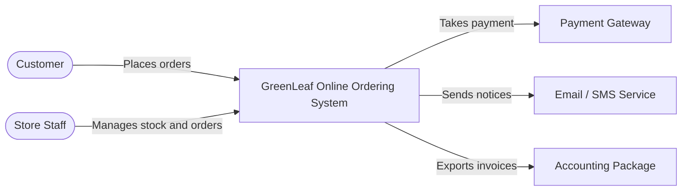

# Employee Onboarding Guide

_Beginner onboarding and the first architecture diagram exercise_

Document VEL-SA-002 · Version 1.0 · 4 November 2026 · VEL Software Solutions · Confidential, internal use

# Beginner Onboarding Guide

Welcome to the Software Architecture & Technical Consulting Department. This guide takes you from your first day to your first reviewed architecture diagram.

## What this department is (and is not)

- **We are** advisers who help clients make sound, explainable technology decisions.
- **We are not** diagram factories. A diagram without a decision, a reason and a requirement behind it has no value.
- **You are** supported: seniors review everything you produce, and mistakes found in review are learning, not failure.

## Before day 1 (manager checklist)

- [ ] Laptop, company email, GitHub organisation access (least privilege), VS Code installed
- [ ] Password manager and multi-factor authentication enabled
- [ ] Read confidentiality and acceptable-use policies; sign acknowledgement
- [ ] Assign a mentor (Solution Architect) and a reviewer (Principal Architect)
- [ ] Create the trainee's training repository from architecture-project-template/

## First week plan

| Day | Learn | Do | Output | Sign-off |
|---|---|---|---|---|
| 1 | Department purpose; golden rules; how a project flows (Chapter 6) | Tool setup; clone the template repo; read the 15 stages | Setup checklist signed; 1-paragraph summary of the lifecycle in own words | Mentor |
| 2 | Level 1: software, servers, networks, APIs | Call a public API in Postman; trace DNS | Notes + screenshots in /reviews/week1 | Mentor |
| 3 | Level 1: databases, cloud, security basics | Explain IaaS/PaaS/SaaS with examples | One-page explainer | Mentor |
| 4 | Layered architecture; three-tier | Lesson L-02: draw first diagram (Chapter 11) | Diagram v1 | Mentor |
| 5 | Review and feedback | Revise diagram; write 5 lessons learned | Diagram v2 + review record | Principal / Solution Architect |

## Daily working rhythm

1. Morning: read your mentor's notes and today's learning objective.
2. Study and practise (about 50% of time in first 30 days).
3. Produce one written artefact per day (note, diagram, ADR draft).
4. Commit work to Git with a clear message; open a pull request for review.
5. End of day: write three lines: done, blocked, next.

## How to ask for help

- Try for 20-30 minutes; write down what you tried and what you expected.
- Ask your mentor with that note. Questions with context get answers in minutes.
- Never guess a client fact. Mark it ASSUMPTION and ask.

> **Professional conduct** — Client information is confidential. Never paste client data into public tools. Never store secrets in Git. Never email client documents to personal accounts. Report mistakes immediately: speed matters more than blame.

## Your first 30-60-90 days at a glance

| Period | Goal | Evidence |
|---|---|---|
| Days 1-30 | Understand fundamentals and business analysis; produce first diagrams | Levels 1-2 passed; Projects 1-2 reviewed |
| Days 31-60 | Architecture fundamentals, patterns, technical architecture | Levels 3-5 passed; Projects 3-6 reviewed |
| Days 61-90 | Evaluation, governance and a full simulated proposal | Levels 6-7 passed; Projects 7-9 reviewed; supervised shadowing of a real engagement |

# First Architecture Diagram Exercise

**Objective:** draw a clear **three-tier application architecture** for a simulated client, then create the matching **C4 Level 1 system context diagram**. You will use draw.io (visual) and Mermaid or PlantUML (diagram-as-code).

> **Simulated client (fictional)** — **GreenLeaf Organics** sells organic produce. Today orders arrive by phone and WhatsApp and are written into a spreadsheet. The owner wants customers to order online, pay by card, and receive confirmation by SMS/email. Store staff must see and update orders and stock. Accounting uses an existing package. Expected: 200 concurrent users at peak (ASSUMED). Budget and date: unknown.

## Step-by-step

1. **Read the brief twice.** Underline actors (customer, staff) and external systems (payment gateway, SMS/email, accounting).
2. **List 8 requirements** (4 functional, 4 non-functional with numbers). Mark each CONFIRMED, ASSUMED or UNKNOWN. In this brief, almost all are ASSUMED.
3. **Open draw.io** and create a new diagram. Name the file `greenleaf-three-tier-v1.drawio`; save it in `diagrams/containers/`.
4. **Draw three columns/boxes:** Presentation (web UI in the browser), Application (business logic and API on servers), Data (SQL database). Label each with its technology only if justified; otherwise label the role.
5. **Draw arrows** with labels: HTTPS, JSON/REST, SQL. Arrows go only between neighbouring tiers.
6. **Draw the network boundary** around everything except the customer. Add a legend and a title with the date and version.
7. **Check:** can the browser reach the database directly? It must not.
8. **Export** SVG and PNG next to the source file. Commit with the message `docs: add three-tier diagram v1`.
9. **Draw the C4 Level 1 context diagram** (next page): one box for the system, people and external systems around it, labelled relationships.
10. **Write the one-paragraph explanation** a non-technical owner can understand, plus 3 assumptions and 3 open questions.
11. **Submit** a pull request to your mentor.

*Figure: **Figure 11.1** Answer key: three-tier architecture for GreenLeaf Organics (training example).*

*Figure: **Figure 11.2** Answer key: C4 Level 1 system context (training example).*



## PlantUML version of the same context diagram

```plantuml
@startuml
!include https://raw.githubusercontent.com/plantuml-stdlib/C4-PlantUML/master/C4_Context.puml
title System Context: GreenLeaf Online Ordering (FICTIONAL EXAMPLE)
Person(customer, "Customer", "Buys organic produce online")
Person(staff, "Store Staff", "Manages stock and orders")
System(sys, "GreenLeaf Online Ordering System", "Takes and tracks orders")
System_Ext(pay, "Payment Gateway", "Card payments")
System_Ext(msg, "Email / SMS Service", "Customer notices")
System_Ext(acc, "Accounting Package", "Existing finance system")
Rel(customer, sys, "Places orders", "HTTPS")
Rel(staff, sys, "Manages stock and orders", "HTTPS")
Rel(sys, pay, "Takes payment", "HTTPS/API")
Rel(sys, msg, "Sends notices", "HTTPS/API")
Rel(sys, acc, "Exports invoices", "File/API")
@enduml
```

> **Rendering** — Paste the Mermaid source into any Mermaid renderer or a GitHub Markdown code block tagged `mermaid`. For PlantUML use the VS Code PlantUML extension. Check the official sites (Chapter 14) for current syntax and the C4-PlantUML include path.

## Marking rubric (100 marks)

| Criterion | Marks | Full marks when |
|---|---|---|
| Correct tiers and responsibilities | 20 | Three tiers present with correct roles |
| Correct dependencies | 15 | Only neighbour-to-neighbour; no browser-to-database arrow |
| Labels and protocols | 15 | Every arrow labelled with what flows and how |
| Boundaries and legend | 10 | Network/trust boundary, legend, title, date, version |
| C4 context correctness | 20 | Actors, system, external systems, relationships, no internal detail |
| Plain-language explanation | 10 | Owner could understand it; no unexplained jargon |
| Assumptions and open questions | 10 | Honest labelling; none presented as fact |

**Pass mark:** 75. Below 75: revise and resubmit once. The reviewer records feedback in `reviews/`.

## Common mistakes in this exercise

- Naming products (e.g. "MongoDB") before any requirement justifies them.
- Drawing every possible box. A context diagram should have fewer than 10.
- Arrows with no label or no direction.
- Mixing levels: a database table in a context diagram.
- Treating assumptions as facts.
